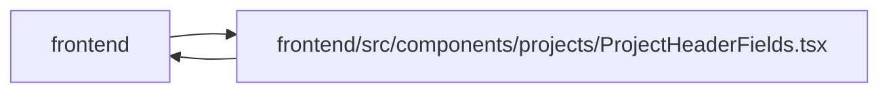

# ProjectHeaderFields Module

**Path:** `frontend/src/components/projects/ProjectHeaderFields.tsx`

## Description

_Auto-generated from `frontend/src/components/projects/ProjectHeaderFields.tsx`._

## Imports

| Source | Symbols | Type-only | Runtime emission |
|--------|---------|-----------|------------------|
| `../../components/common/Select` | `Select` | — | compiler-dependent |
| `../../services/planningInputService` | `ObservedPlanningInput` | Declaration | erased |
| `../../services/projectService` | `projectService` | — | compiler-dependent |
| `../../services/teamService` | `teamService` | — | compiler-dependent |
| `../../types/project` | `Project`, `ProjectUpdate` | Declaration | erased |
| `../../utils/apiError` | `getApiErrorMessage`, `getApiErrorStatus` | — | compiler-dependent |
| `../../utils/formatDate` | `formatDate` | — | compiler-dependent |
| `../../utils/teamMemberLabels` | `formatPortfolioOwnerLabel`, `formatTeamMemberProfileLabel` | — | compiler-dependent |
| `../common/Button` | `Button` | — | compiler-dependent |
| `../feedback/QueryState` | `QueryErrorState` | — | compiler-dependent |
| `../planning/PlanningInputBoundary` | `PlanningInputBoundary` | — | compiler-dependent |
| `./projectDetailShared` | `healthLabelKeys`, `projectStatusLabelKeys` | — | compiler-dependent |
| `@tanstack/react-query` | `useMutation`, `useQuery`, `useQueryClient` | — | compiler-dependent |
| `lucide-react` | `Pencil` | — | compiler-dependent |
| `react` | `ReactNode` | Specifier | compiler-dependent |
| `react` | `useState` | — | compiler-dependent |
| `react-i18next` | `useTranslation` | — | compiler-dependent |

## Module Signals

| Signal | Values |
|--------|--------|
| Exports | `ProjectHeaderFields` |
| Constants | `inputClass` |

## Local dependency map

<!-- Auto-generated local dependency summary. Do not edit by hand. -->
This graph shows full source coupling. Type dependencies can be erased; compiler-dependent cycle groups are runtime candidates, not confirmed initialization cycles.

> Module-level dependencies exceed the generated-diagram limits, so the diagram and table below group them by top-level package. Counts report the number of module neighbors in each package.

### Internal neighbors

| Direction | Module |
|---|---|
| Inbound | `frontend` (1) |
| Outbound | `frontend` (12) |

### External packages

| Language | Used packages | Undeclared packages |
|---|---:|---:|
| typescript | 4 | 0 |

> All 13 module neighbor(s) are summarized by package because the module-level view exceeds the 12-node limit.

## Classes

| Class | Kind | Line | Bases / Target | Description |
|-------|------|------|----------------|-------------|
| [Field](../entities/Field.md) | Type alias | 18 | `'status' \| 'health' \| 'dates' \| 'owner'` | — |

## Functions

| Function | Signature | Decorators | Description |
|----------|-----------|------------|-------------|
| `ProjectHeaderFields` | `({ project }: { project: Project })` | — | — |
