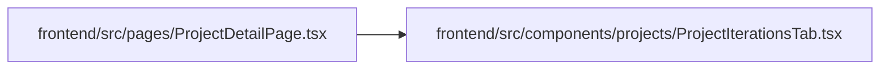

# ProjectIterationsTab Module

**Path:** `frontend/src/components/projects/ProjectIterationsTab.tsx`

## Description

_Auto-generated from `frontend/src/components/projects/ProjectIterationsTab.tsx`._

## Module Signals

| Signal | Values |
|--------|--------|
| Exports | `ProjectIterationsSection`, `ProjectIterationsTab` |

## Local dependency map

<!-- Auto-generated local dependency summary. Do not edit by hand. -->

### Internal neighbors

| Direction | Module |
|---|---|
| Inbound | [ProjectDetailPage](../modules/ProjectDetailPage.md) |
