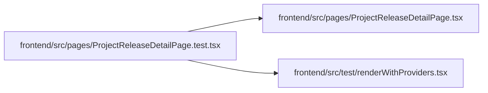

# ProjectReleaseDetailPage.test Module

**Path:** `frontend/src/pages/ProjectReleaseDetailPage.test.tsx`

## Description

_Auto-generated from `frontend/src/pages/ProjectReleaseDetailPage.test.tsx`._

## Imports

| Source | Symbols | Type-only | Runtime emission |
|--------|---------|-----------|------------------|
| `../test/renderWithProviders` | `renderWithProviders` | — | compiler-dependent |
| `./ProjectReleaseDetailPage` | `ProjectReleaseDetailPage` | — | compiler-dependent |
| `@testing-library/react` | `screen`, `within` | — | compiler-dependent |
| `react-router-dom` | `Route`, `Routes` | — | compiler-dependent |
| `vitest` | `beforeEach`, `expect`, `it`, `vi` | — | compiler-dependent |

## Module Signals

| Signal | Values |
|--------|--------|
| Constants | `services` |
| Module calls | `services = hoisted`, `mock`, `mock`, `mock`, `mock`, `beforeEach`, `it`, `it`, `it`, `it`, `it`, `it.each(['project', 'release'] as const)` |

## Local dependency map

<!-- Auto-generated local dependency summary. Do not edit by hand. -->

### Internal neighbors

| Direction | Module |
|---|---|
| Outbound | [ProjectReleaseDetailPage](../modules/ProjectReleaseDetailPage.md) |
| Outbound | [renderWithProviders](../modules/renderWithProviders.md) |

### External packages

| Language | Used packages | Undeclared packages |
|---|---:|---:|
| typescript | 3 | 0 |
