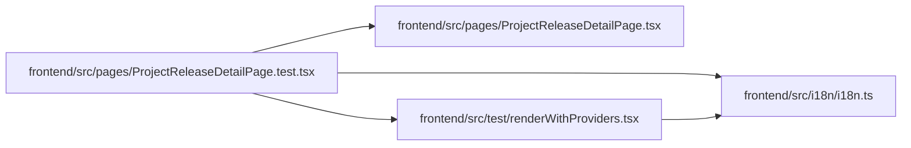

# ProjectReleaseDetailPage.test Module

**Path:** `frontend/src/pages/ProjectReleaseDetailPage.test.tsx`

## Description

_Auto-generated from `frontend/src/pages/ProjectReleaseDetailPage.test.tsx`._

## Imports

| Source | Symbols | Type-only | Runtime emission |
|--------|---------|-----------|------------------|
| `../i18n/i18n` | `changeAppLanguage` | — | compiler-dependent |
| `../test/renderWithProviders` | `renderWithProviders` | — | compiler-dependent |
| `./ProjectReleaseDetailPage` | `ProjectReleaseDetailPage` | — | compiler-dependent |
| `@testing-library/react` | `screen`, `waitFor`, `within` | — | compiler-dependent |
| `react-router-dom` | `Route`, `Routes` | — | compiler-dependent |
| `vitest` | `afterEach`, `beforeEach`, `expect`, `it`, `vi` | — | compiler-dependent |

## Module Signals

| Signal | Values |
|--------|--------|
| Constants | `services` |
| Module calls | `services = hoisted`, `mock`, `mock`, `mock`, `mock`, `beforeEach`, `afterEach`, `it.each([
    ['closed', [task(1, 'closed'), task(2, 'closed')]],
    ['resolved', [task(1, 'resolved')]],
    ['canceled', [task(1, 'active', 'canceled')]],
    ['superseded', [task(1, 'planned', 'superseded')]],
    ['empty', []],
])`, `it`, `it.each([
    ['en', 1, '1 linked task still needs resolution.'],
    ['en', 2, '2 linked tasks still need resolution.'],
    ['ru', 1, '1 связанная задача ещё требует решения.'],
    ['ru', 2, '2 связанные задачи ещё требуют решения.'],
    ['ru', 5, '5 связанных задач ещё требуют решения.'],
])`, `it`, `it`, `it`, `it`, `it`, `it`, `it.each(['project', 'release'] as const)` |

## Local dependency map

<!-- Auto-generated local dependency summary. Do not edit by hand. -->

### Internal neighbors

| Direction | Module |
|---|---|
| Outbound | [i18n](../modules/i18n.md) |
| Outbound | [ProjectReleaseDetailPage](../modules/ProjectReleaseDetailPage.md) |
| Outbound | [renderWithProviders](../modules/renderWithProviders.md) |

### External packages

| Language | Used packages | Undeclared packages |
|---|---:|---:|
| typescript | 3 | 0 |
