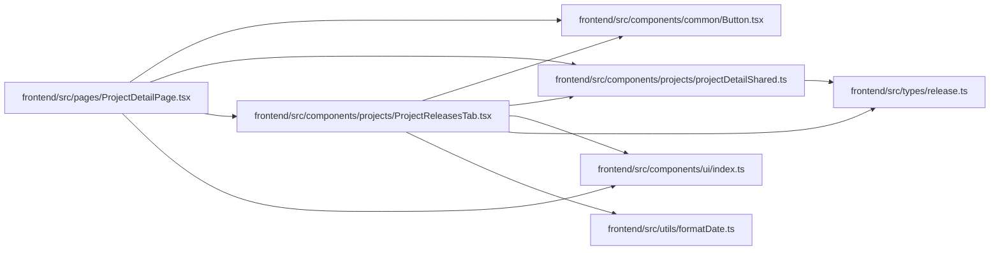

# ProjectReleasesTab Module

**Path:** `frontend/src/components/projects/ProjectReleasesTab.tsx`

## Description

_Auto-generated from `frontend/src/components/projects/ProjectReleasesTab.tsx`._

## Imports

| Source | Symbols | Type-only | Runtime emission |
|--------|---------|-----------|------------------|
| `../../types/release` | `Release` | Declaration | erased |
| `../../utils/formatDate` | `formatDate` | — | compiler-dependent |
| `../common/Button` | `Button` | — | compiler-dependent |
| `../ui` | `SectionCard` | — | compiler-dependent |
| `./projectDetailShared` | `releaseBadgeClassName`, `releaseStatusLabelKeys`, `t` | — | compiler-dependent |
| `clsx` | `clsx` | — | compiler-dependent |
| `lucide-react` | `Package`, `Plus` | — | compiler-dependent |
| `react-router-dom` | `Link` | — | compiler-dependent |

## Module Signals

| Signal | Values |
|--------|--------|
| Exports | `ProjectReleasesTab` |

## Local dependency map

<!-- Auto-generated local dependency summary. Do not edit by hand. -->
This graph shows full source coupling. Type dependencies can be erased; compiler-dependent cycle groups are runtime candidates, not confirmed initialization cycles.

### Internal neighbors

| Direction | Module |
|---|---|
| Inbound | [ProjectDetailPage](../modules/ProjectDetailPage.md) |
| Outbound | [Button](../modules/Button.md) |
| Outbound | [projectDetailShared](../modules/projectDetailShared.md) |
| Outbound | [index](../modules/index.md) |
| Outbound | [types_release](../modules/types_release.md) |
| Outbound | [formatDate](../modules/formatDate.md) |

### External packages

| Language | Used packages | Undeclared packages |
|---|---:|---:|
| typescript | 3 | 0 |

## Functions

| Function | Signature | Decorators | Description |
|----------|-----------|------------|-------------|
| `ProjectReleasesTab` | <pre><code>&#40;&#123;&#10;    releases&#44;&#10;    isLoading&#44;&#10;    onCreate&#44;&#10;&#125;&#58; &#123;&#10;    releases&#58; Release&#91;&#93;&#59;&#10;    isLoading&#58; boolean&#59;&#10;    onCreate&#58; &#40;&#41; &#61;&#62; void&#59;&#10;&#125;&#41;</code></pre> | — | — |
