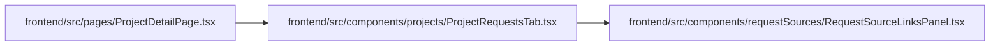

# ProjectRequestsTab Module

**Path:** `frontend/src/components/projects/ProjectRequestsTab.tsx`

## Description

_Auto-generated from `frontend/src/components/projects/ProjectRequestsTab.tsx`._

## Imports

| Source | Symbols | Type-only | Runtime emission |
|--------|---------|-----------|------------------|
| `../requestSources/RequestSourceLinksPanel` | `RequestSourceLinksPanel` | — | compiler-dependent |
| `react-i18next` | `useTranslation` | — | compiler-dependent |

## Module Signals

| Signal | Values |
|--------|--------|
| Exports | `ProjectRequestsTab` |

## Local dependency map

<!-- Auto-generated local dependency summary. Do not edit by hand. -->

### Internal neighbors

| Direction | Module |
|---|---|
| Inbound | [ProjectDetailPage](../modules/ProjectDetailPage.md) |
| Outbound | [RequestSourceLinksPanel](../modules/RequestSourceLinksPanel.md) |

### External packages

| Language | Used packages | Undeclared packages |
|---|---:|---:|
| typescript | 1 | 0 |

## Functions

| Function | Signature | Decorators | Description |
|----------|-----------|------------|-------------|
| `ProjectRequestsTab` | `({ projectId, count, onChanged }: { projectId: number; count: number; onChanged: () => void })` | — | — |
