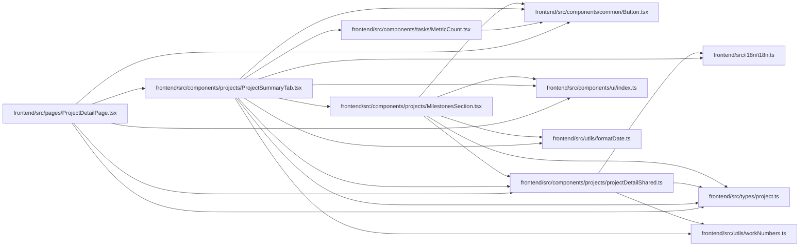

# ProjectSummaryTab Module

**Path:** `frontend/src/components/projects/ProjectSummaryTab.tsx`

## Description

_Auto-generated from `frontend/src/components/projects/ProjectSummaryTab.tsx`._

## Imports

| Source | Symbols | Type-only | Runtime emission |
|--------|---------|-----------|------------------|
| `../../i18n/i18n` | `i18n` | — | compiler-dependent |
| `../../types/project` | `Project`, `ProjectUpdateEntry` | Declaration | erased |
| `../../utils/formatDate` | `formatDate`, `formatDateTime` | — | compiler-dependent |
| `../../utils/workNumbers` | `formatEffortDays` | — | compiler-dependent |
| `../common/Button` | `Button` | — | compiler-dependent |
| `../tasks/MetricCount` | `MetricCount` | — | compiler-dependent |
| `../ui` | `InlineEmptyState`, `Pill`, `SectionCard`, `StickyRail` | — | compiler-dependent |
| `./MilestonesSection` | `MilestonesSection` | — | compiler-dependent |
| `./projectDetailShared` | `formatNumber`, `formatUpdateAge`, `healthDotClass`, `healthLabelKeys`, `healthToTone`, `riskLabelKeys`, `riskTone`, `updateDetailFields`, `updateFreshnessMessage`, `updateFreshnessLabelKeys` | — | compiler-dependent |
| `clsx` | `clsx` | — | compiler-dependent |
| `lucide-react` | `Activity`, `AlertTriangle`, `MessageSquare`, `Send` | — | compiler-dependent |
| `react` | `ComponentProps` | Declaration | erased |
| `react-i18next` | `useTranslation` | — | compiler-dependent |

## Module Signals

| Signal | Values |
|--------|--------|
| Exports | `ProjectSummaryTab` |

## Local dependency map

<!-- Auto-generated local dependency summary. Do not edit by hand. -->
This graph shows full source coupling. Type dependencies can be erased; compiler-dependent cycle groups are runtime candidates, not confirmed initialization cycles.

### Internal neighbors

| Direction | Module |
|---|---|
| Inbound | [ProjectDetailPage](../modules/ProjectDetailPage.md) |
| Outbound | [Button](../modules/Button.md) |
| Outbound | [MilestonesSection](../modules/MilestonesSection.md) |
| Outbound | [projectDetailShared](../modules/projectDetailShared.md) |
| Outbound | [MetricCount](../modules/MetricCount.md) |
| Outbound | [index](../modules/index.md) |
| Outbound | [i18n](../modules/i18n.md) |
| Outbound | [types_project](../modules/types_project.md) |
| Outbound | [formatDate](../modules/formatDate.md) |
| Outbound | [workNumbers](../modules/workNumbers.md) |

### External packages

| Language | Used packages | Undeclared packages |
|---|---:|---:|
| typescript | 4 | 0 |

## Functions

| Function | Signature | Decorators | Description |
|----------|-----------|------------|-------------|
| `ProjectSummaryTab` | <pre><code>&#40;&#123; project&#44; summary&#44; updates&#58; projectUpdates&#44; milestones&#44; onPostUpdate &#125;&#58; &#123;&#10;    project&#58; Project&#59; summary&#63;&#58; import&#40;&#39;&#46;&#46;&#47;&#46;&#46;&#47;types&#47;project&#39;&#41;&#46;ProjectSummary&#59; updates&#58; ProjectUpdateEntry&#91;&#93;&#59;&#10;    milestones&#58; ComponentProps&#60;typeof MilestonesSection&#62;&#59; onPostUpdate&#58; &#40;&#41; &#61;&#62; void&#59;&#10;&#125;&#41;</code></pre> | — | — |
