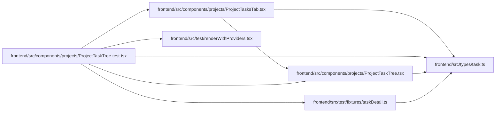

# ProjectTaskTree.test Module

**Path:** `frontend/src/components/projects/ProjectTaskTree.test.tsx`

## Description

_Auto-generated from `frontend/src/components/projects/ProjectTaskTree.test.tsx`._

## Imports

| Source | Symbols | Type-only | Runtime emission |
|--------|---------|-----------|------------------|
| `../../test/fixtures/taskDetail` | `taskDetailResponse` | — | compiler-dependent |
| `../../test/renderWithProviders` | `renderWithProviders` | — | compiler-dependent |
| `../../types/task` | `Task` | Declaration | erased |
| `./ProjectTaskTree` | `ProjectTaskTree` | — | compiler-dependent |
| `./ProjectTasksTab` | `ProjectTasksTab` | — | compiler-dependent |
| `@testing-library/react` | `fireEvent`, `screen`, `waitFor`, `within` | — | compiler-dependent |
| `vitest` | `beforeEach`, `describe`, `expect`, `it`, `vi` | — | compiler-dependent |

## Module Signals

| Signal | Values |
|--------|--------|
| Constants | `services` |
| Module calls | `services = hoisted`, `mock`, `mock`, `mock`, `mock`, `beforeEach`, `describe` |

## Local dependency map

<!-- Auto-generated local dependency summary. Do not edit by hand. -->
This graph shows full source coupling. Type dependencies can be erased; compiler-dependent cycle groups are runtime candidates, not confirmed initialization cycles.

### Internal neighbors

| Direction | Module |
|---|---|
| Outbound | [ProjectTasksTab](../modules/ProjectTasksTab.md) |
| Outbound | [ProjectTaskTree](../modules/ProjectTaskTree.md) |
| Outbound | [taskDetail](../modules/taskDetail.md) |
| Outbound | [renderWithProviders](../modules/renderWithProviders.md) |
| Outbound | [types_task](../modules/types_task.md) |

### External packages

| Language | Used packages | Undeclared packages |
|---|---:|---:|
| typescript | 2 | 0 |
