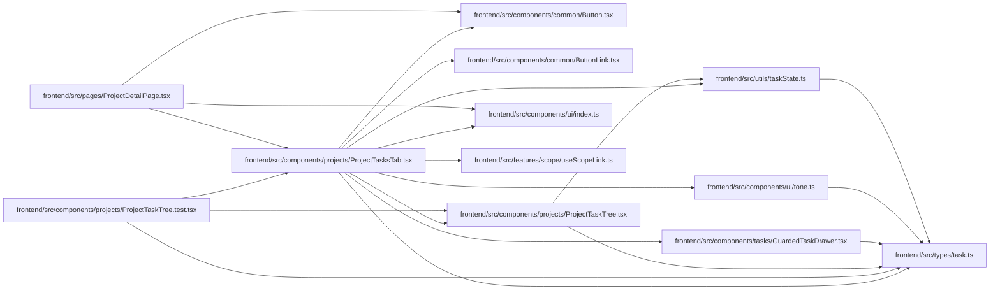

# ProjectTasksTab Module

**Path:** `frontend/src/components/projects/ProjectTasksTab.tsx`

## Description

_Auto-generated from `frontend/src/components/projects/ProjectTasksTab.tsx`._

## Imports

| Source | Symbols | Type-only | Runtime emission |
|--------|---------|-----------|------------------|
| `../../features/scope/useScopeLink` | `useScopeLink` | — | compiler-dependent |
| `../../types/task` | `Task`, `TaskDisplayedState` | Declaration | erased |
| `../../utils/taskState` | `stateOf` | — | compiler-dependent |
| `../common/Button` | `Button` | — | compiler-dependent |
| `../common/ButtonLink` | `ButtonLink` | — | compiler-dependent |
| `../tasks/GuardedTaskDrawer` | `GuardedTaskDrawer` | — | compiler-dependent |
| `../ui` | `InlineEmptyState`, `SectionCard`, `StatusSegmentStrip` | — | compiler-dependent |
| `../ui/tone` | `STATE_TONE`, `STATUS_TONE` | — | compiler-dependent |
| `./ProjectTaskTree` | `ProjectTaskTree` | — | compiler-dependent |
| `lucide-react` | `CheckCircle2`, `Plus` | — | compiler-dependent |
| `react` | `useState` | — | compiler-dependent |
| `react-i18next` | `useTranslation` | — | compiler-dependent |
| `react-router-dom` | `useNavigate` | — | compiler-dependent |

## Module Signals

| Signal | Values |
|--------|--------|
| Exports | `ProjectTasksTab` |

## Local dependency map

<!-- Auto-generated local dependency summary. Do not edit by hand. -->
This graph shows full source coupling. Type dependencies can be erased; compiler-dependent cycle groups are runtime candidates, not confirmed initialization cycles.

### Internal neighbors

| Direction | Module |
|---|---|
| Inbound | [ProjectTaskTree.test](../modules/ProjectTaskTree.test.md) |
| Inbound | [ProjectDetailPage](../modules/ProjectDetailPage.md) |
| Outbound | [Button](../modules/Button.md) |
| Outbound | [ButtonLink](../modules/ButtonLink.md) |
| Outbound | [ProjectTaskTree](../modules/ProjectTaskTree.md) |
| Outbound | [GuardedTaskDrawer](../modules/GuardedTaskDrawer.md) |
| Outbound | [index](../modules/index.md) |
| Outbound | [tone](../modules/tone.md) |
| Outbound | [useScopeLink](../modules/useScopeLink.md) |
| Outbound | [types_task](../modules/types_task.md) |
| Outbound | [taskState](../modules/taskState.md) |

### External packages

| Language | Used packages | Undeclared packages |
|---|---:|---:|
| typescript | 4 | 0 |

## Functions

| Function | Signature | Decorators | Description |
|----------|-----------|------------|-------------|
| `ProjectTasksTab` | <pre><code>&#40;&#123; tasks&#44; summary&#44; projectId&#58; numericProjectId&#44; isLoading&#58; areTasksLoading &#125;&#58; &#123;&#10;    tasks&#58; Task&#91;&#93;&#59; summary&#63;&#58; import&#40;&#39;&#46;&#46;&#47;&#46;&#46;&#47;types&#47;project&#39;&#41;&#46;ProjectSummary&#59; projectId&#58; number&#59; isLoading&#58; boolean&#59;&#10;&#125;&#41;</code></pre> | — | — |
