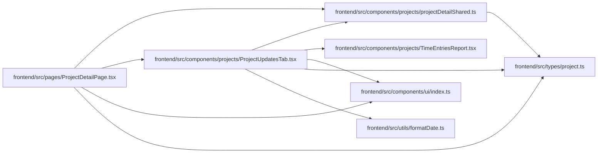

# ProjectUpdatesTab Module

**Path:** `frontend/src/components/projects/ProjectUpdatesTab.tsx`

## Description

_Auto-generated from `frontend/src/components/projects/ProjectUpdatesTab.tsx`._

## Imports

| Source | Symbols | Type-only | Runtime emission |
|--------|---------|-----------|------------------|
| `../../types/project` | `ProjectUpdateEntry` | Declaration | erased |
| `../../utils/formatDate` | `formatDateTime` | — | compiler-dependent |
| `../ui` | `Pill`, `SectionCard` | — | compiler-dependent |
| `./TimeEntriesReport` | `TimeEntriesReport` | — | compiler-dependent |
| `./projectDetailShared` | `healthDotClass`, `healthLabelKeys`, `healthToTone`, `updateDetailFields` | — | compiler-dependent |
| `clsx` | `clsx` | — | compiler-dependent |
| `react-i18next` | `useTranslation` | — | compiler-dependent |

## Module Signals

| Signal | Values |
|--------|--------|
| Exports | `ProjectUpdatesTab` |

## Local dependency map

<!-- Auto-generated local dependency summary. Do not edit by hand. -->
This graph shows full source coupling. Type dependencies can be erased; compiler-dependent cycle groups are runtime candidates, not confirmed initialization cycles.

### Internal neighbors

| Direction | Module |
|---|---|
| Inbound | [ProjectDetailPage](../modules/ProjectDetailPage.md) |
| Outbound | [projectDetailShared](../modules/projectDetailShared.md) |
| Outbound | [TimeEntriesReport](../modules/TimeEntriesReport.md) |
| Outbound | [index](../modules/index.md) |
| Outbound | [types_project](../modules/types_project.md) |
| Outbound | [formatDate](../modules/formatDate.md) |

### External packages

| Language | Used packages | Undeclared packages |
|---|---:|---:|
| typescript | 2 | 0 |

## Functions

| Function | Signature | Decorators | Description |
|----------|-----------|------------|-------------|
| `ProjectUpdatesTab` | <pre><code>&#40;&#123; projectId&#44; updates&#58; projectUpdates&#44; isLoading&#58; areUpdatesLoading &#125;&#58; &#123;&#10;    projectId&#58; number&#59; updates&#58; ProjectUpdateEntry&#91;&#93;&#59; isLoading&#58; boolean&#59;&#10;&#125;&#41;</code></pre> | — | — |
