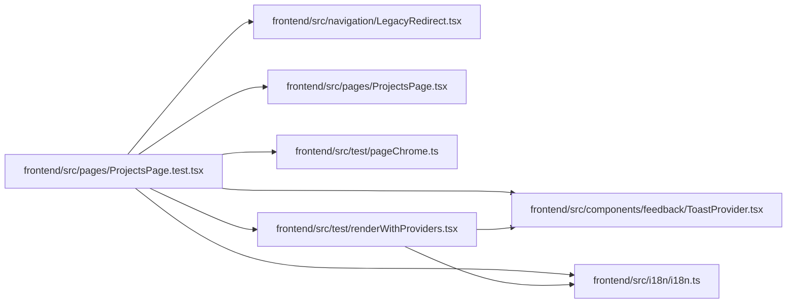

# ProjectsPage.test Module

**Path:** `frontend/src/pages/ProjectsPage.test.tsx`

## Description

_Auto-generated from `frontend/src/pages/ProjectsPage.test.tsx`._

## Imports

| Source | Symbols | Type-only | Runtime emission |
|--------|---------|-----------|------------------|
| `../components/feedback/ToastProvider` | `ToastProvider` | — | compiler-dependent |
| `../i18n/i18n` | `i18n` | — | compiler-dependent |
| `../navigation/LegacyRedirect` | `LegacyRedirect` | — | compiler-dependent |
| `../test/pageChrome` | `expectPageChrome` | — | compiler-dependent |
| `../test/renderWithProviders` | `createTestQueryClient`, `renderWithProviders` | — | compiler-dependent |
| `./ProjectsPage` | `ProjectsPage` | — | compiler-dependent |
| `@tanstack/react-query` | `QueryClientProvider` | — | compiler-dependent |
| `@testing-library/react` | `render`, `screen`, `waitFor`, `within` | — | compiler-dependent |
| `@testing-library/user-event` | `userEvent` | — | compiler-dependent |
| `date-fns` | `addDays`, `format` | — | compiler-dependent |
| `react-router-dom` | `createMemoryRouter`, `RouterProvider`, `useLocation` | — | compiler-dependent |
| `vitest` | `beforeEach`, `describe`, `expect`, `it`, `vi` | — | compiler-dependent |

## Module Signals

| Signal | Values |
|--------|--------|
| Constants | `projectServiceMock`, `savedViewServiceMock`, `planningInputServiceMock`, `project`, `ownerProfile`, `launchInitiative`, `milestone` |
| Module calls | `projectServiceMock = hoisted`, `savedViewServiceMock = hoisted`, `planningInputServiceMock = hoisted`, `mock`, `mock`, `mock`, `mock`, `describe`, `describe` |

## Local dependency map

<!-- Auto-generated local dependency summary. Do not edit by hand. -->

### Internal neighbors

| Direction | Module |
|---|---|
| Outbound | [ToastProvider](../modules/ToastProvider.md) |
| Outbound | [i18n](../modules/i18n.md) |
| Outbound | [LegacyRedirect](../modules/LegacyRedirect.md) |
| Outbound | [ProjectsPage](../modules/ProjectsPage.md) |
| Outbound | [pageChrome](../modules/pageChrome.md) |
| Outbound | [renderWithProviders](../modules/renderWithProviders.md) |

### External packages

| Language | Used packages | Undeclared packages |
|---|---:|---:|
| typescript | 6 | 0 |
