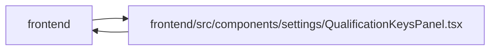

# QualificationKeysPanel Module

**Path:** `frontend/src/components/settings/QualificationKeysPanel.tsx`

## Description

_Auto-generated from `frontend/src/components/settings/QualificationKeysPanel.tsx`._

## Imports

| Source | Symbols | Type-only | Runtime emission |
|--------|---------|-----------|------------------|
| `../../services/agentService` | `agentService` | — | compiler-dependent |
| `../../types/agent` | `RoutingQualificationKey` | Declaration | erased |
| `../../utils/apiError` | `normalizeApiError` | — | compiler-dependent |
| `../../utils/formatDate` | `formatDateTime` | — | compiler-dependent |
| `../../utils/modelRouting` | `createAgentCommandMetadata` | — | compiler-dependent |
| `../../utils/protectedQueries` | `protectedQueryRetry` | — | compiler-dependent |
| `../common/Button` | `Button` | — | compiler-dependent |
| `../common/Checkbox` | `Checkbox` | — | compiler-dependent |
| `../common/Input` | `Input` | — | compiler-dependent |
| `../common/Modal` | `Modal` | — | compiler-dependent |
| `../common/Textarea` | `Textarea` | — | compiler-dependent |
| `../feedback/QueryState` | `QueryErrorState`, `QueryLoadingState` | — | compiler-dependent |
| `../feedback/toast` | `useToast` | — | compiler-dependent |
| `@tanstack/react-query` | `useMutation`, `useQuery`, `useQueryClient` | — | compiler-dependent |
| `lucide-react` | `BadgeCheck`, `Plus` | — | compiler-dependent |
| `react` | `FormEvent` | Declaration | erased |
| `react` | `useState` | — | compiler-dependent |
| `react-i18next` | `useTranslation` | — | compiler-dependent |

## Module Signals

| Signal | Values |
|--------|--------|
| Exports | `QualificationKeysPanel` |
| Constants | `REGISTRY_QUERY_KEY` |

## Local dependency map

<!-- Auto-generated local dependency summary. Do not edit by hand. -->
This graph shows full source coupling. Type dependencies can be erased; compiler-dependent cycle groups are runtime candidates, not confirmed initialization cycles.

> Module-level dependencies exceed the generated-diagram limits, so the diagram and table below group them by top-level package. Counts report the number of module neighbors in each package.

### Internal neighbors

| Direction | Module |
|---|---|
| Inbound | `frontend` (2) |
| Outbound | `frontend` (13) |

### External packages

| Language | Used packages | Undeclared packages |
|---|---:|---:|
| typescript | 4 | 0 |

> All 15 module neighbor(s) are summarized by package because the module-level view exceeds the 12-node limit.

## Classes

| Class | Kind | Line | Bases / Target | Description |
|-------|------|------|----------------|-------------|
| [InUseDetail](../entities/InUseDetail.md) | Interface | 28 | — | — |
| [Dialog](../entities/Dialog.md) | Type alias | 22 | <pre><code>&#124; &#123; kind&#58; &#39;declare&#39;&#59; key&#58; string&#59; label&#58; string&#59; description&#58; string&#59; locked&#58; boolean &#125;&#10;    &#124; &#123; kind&#58; &#39;revise&#39;&#59; entry&#58; RoutingQualificationKey&#59; label&#58; string&#59; description&#58; string &#125;&#10;    &#124; &#123; kind&#58; &#39;retire&#39;&#59; entry&#58; RoutingQualificationKey &#125;&#10;    &#124; &#123; kind&#58; &#39;history&#39;&#59; entry&#58; RoutingQualificationKey &#125;</code></pre> | — |

## Functions

| Function | Signature | Decorators | Description |
|----------|-----------|------------|-------------|
| `QualificationKeysPanel` | `()` | — | The deployment's declared qualification keys beside the fixed built-in keys. |
