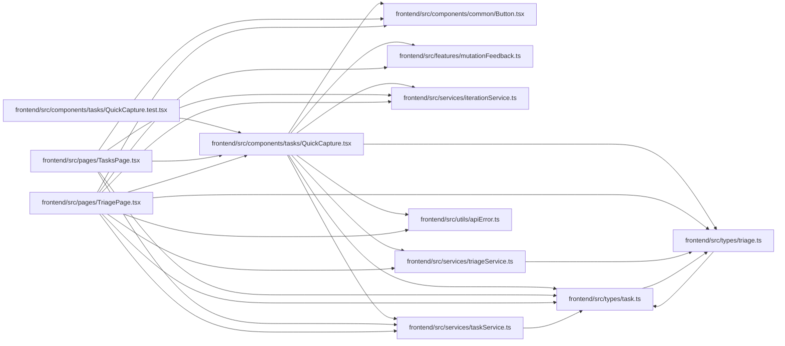

# QuickCapture Module

**Path:** `frontend/src/components/tasks/QuickCapture.tsx`

## Description

_Auto-generated from `frontend/src/components/tasks/QuickCapture.tsx`._

## Imports

| Source | Symbols | Type-only | Runtime emission |
|--------|---------|-----------|------------------|
| `../../features/mutationFeedback` | `MutationFeedbackMeta` | Specifier | compiler-dependent |
| `../../features/mutationFeedback` | `feedbackMessage` | — | compiler-dependent |
| `../../services/iterationService` | `iterationService` | — | compiler-dependent |
| `../../services/taskService` | `taskService` | — | compiler-dependent |
| `../../services/triageService` | `triageService` | — | compiler-dependent |
| `../../types/task` | `Task` | Declaration | erased |
| `../../types/triage` | `TriageItem` | Declaration | erased |
| `../../utils/apiError` | `getApiErrorMessage` | — | compiler-dependent |
| `../common/Button` | `Button` | — | compiler-dependent |
| `@tanstack/react-query` | `useMutation` | — | compiler-dependent |
| `lucide-react` | `CornerDownLeft`, `Plus` | — | compiler-dependent |
| `react` | `FormEvent` | Specifier | compiler-dependent |
| `react` | `useId`, `useRef`, `useState` | — | compiler-dependent |
| `react-i18next` | `useTranslation` | — | compiler-dependent |

## Module Signals

| Signal | Values |
|--------|--------|
| Exports | `QuickCapture`, `QuickCaptureTarget` |

## Local dependency map

<!-- Auto-generated local dependency summary. Do not edit by hand. -->
This graph shows full source coupling. Type dependencies can be erased; compiler-dependent cycle groups are runtime candidates, not confirmed initialization cycles.

### Internal neighbors

| Direction | Module |
|---|---|
| Inbound | [QuickCapture.test](../modules/QuickCapture.test.md) |
| Inbound | [TasksPage](../modules/TasksPage.md) |
| Inbound | [TriagePage](../modules/TriagePage.md) |
| Outbound | [Button](../modules/Button.md) |
| Outbound | [mutationFeedback](../modules/mutationFeedback.md) |
| Outbound | [iterationService](../modules/iterationService.md) |
| Outbound | [taskService](../modules/taskService.md) |
| Outbound | [triageService](../modules/triageService.md) |
| Outbound | [types_task](../modules/types_task.md) |
| Outbound | [types_triage](../modules/types_triage.md) |
| Outbound | [apiError](../modules/apiError.md) |

### External packages

| Language | Used packages | Undeclared packages |
|---|---:|---:|
| typescript | 4 | 0 |

## Classes

| Class | Kind | Line | Bases / Target | Description |
|-------|------|------|----------------|-------------|
| [QuickCaptureTarget](../entities/QuickCaptureTarget.md) | Type alias | 14 | `{ kind: 'task'; iterationId: number } \| { kind: 'triage' }` | — |

## Functions

| Function | Signature | Decorators | Description |
|----------|-----------|------------|-------------|
| `QuickCapture` | `({ target, onExpand }: { target: QuickCaptureTarget; onExpand: (title: string) => void })` | — | One line that captures work from a title and Enter. Priority is left to the |
