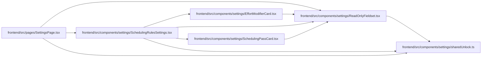

# ReadOnlyFieldset Module

**Path:** `frontend/src/components/settings/ReadOnlyFieldset.tsx`

## Description

_Auto-generated from `frontend/src/components/settings/ReadOnlyFieldset.tsx`._

## Imports

| Source | Symbols | Type-only | Runtime emission |
|--------|---------|-----------|------------------|
| `./sharedUnlock` | `useSettingsReadOnly` | — | compiler-dependent |
| `react` | `ReactNode` | Declaration | erased |

## Module Signals

| Signal | Values |
|--------|--------|
| Exports | `ReadOnlyFieldset` |

## Local dependency map

<!-- Auto-generated local dependency summary. Do not edit by hand. -->

### Internal neighbors

| Direction | Module |
|---|---|
| Inbound | [EffortModifierCard](../modules/EffortModifierCard.md) |
| Inbound | [SchedulingPassCard](../modules/SchedulingPassCard.md) |
| Inbound | [SchedulingRulesSettings](../modules/SchedulingRulesSettings.md) |
| Inbound | [SettingsPage](../modules/SettingsPage.md) |
| Outbound | [sharedUnlock](../modules/sharedUnlock.md) |

### External packages

| Language | Used packages | Undeclared packages |
|---|---:|---:|
| typescript | 1 | 0 |

## Functions

| Function | Signature | Decorators | Description |
|----------|-----------|------------|-------------|
| `ReadOnlyFieldset` | `({ children, disabled = false }: { children: ReactNode; disabled?: boolean })` | — | Wraps editing controls so they are disabled while the surrounding settings |
