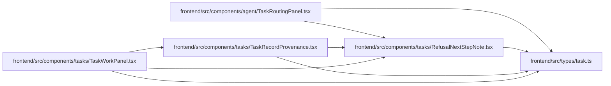

# RefusalNextStepNote Module

**Path:** `frontend/src/components/tasks/RefusalNextStepNote.tsx`

## Description

_Auto-generated from `frontend/src/components/tasks/RefusalNextStepNote.tsx`._

## Imports

| Source | Symbols | Type-only | Runtime emission |
|--------|---------|-----------|------------------|
| `../../types/task` | `RefusalNextStep` | Declaration | erased |
| `i18next` | `TFunction` | Declaration | erased |
| `react-i18next` | `useTranslation` | — | compiler-dependent |

## Module Signals

| Signal | Values |
|--------|--------|
| Exports | `RefusalNextStepNote` |

## Local dependency map

<!-- Auto-generated local dependency summary. Do not edit by hand. -->
This graph shows full source coupling. Type dependencies can be erased; compiler-dependent cycle groups are runtime candidates, not confirmed initialization cycles.

### Internal neighbors

| Direction | Module |
|---|---|
| Inbound | [TaskRoutingPanel](../modules/TaskRoutingPanel.md) |
| Inbound | [TaskRecordProvenance](../modules/TaskRecordProvenance.md) |
| Inbound | [TaskWorkPanel](../modules/TaskWorkPanel.md) |
| Outbound | [types_task](../modules/types_task.md) |

### External packages

| Language | Used packages | Undeclared packages |
|---|---:|---:|
| typescript | 2 | 0 |

## Functions

| Function | Signature | Decorators | Description |
|----------|-----------|------------|-------------|
| `RefusalNextStepNote` | `({ step, className }: { step: RefusalNextStep; className?: string })` | — | What a person may do about a refusal, set beside the refusal. The sentence says what to do; the commands name the |
