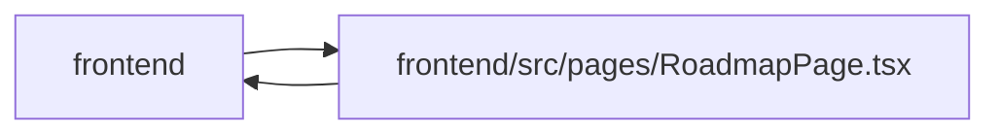

# RoadmapPage Module

**Path:** `frontend/src/pages/RoadmapPage.tsx`

## Description

Milestone continuation is explicit and uses the bounded live window. Reaching the end of a retired window does not establish complete portfolio milestone data; existing date-range and loaded-marker recovery remain visible.

## Imports

| Source | Symbols | Type-only | Runtime emission |
|--------|---------|-----------|------------------|
| `../components/common/Button` | `Button` | — | compiler-dependent |
| `../components/feedback/LiveWindowStatus` | `LiveWindowStatus` | — | compiler-dependent |
| `../components/feedback/QueryState` | `QueryErrorState`, `QueryStaleState` | — | compiler-dependent |
| `../components/planning/PlanningWorkbenchFrame` | `PlanningWorkbenchFrame` | — | compiler-dependent |
| `../components/projects/projectStatusStyles` | `projectStatusBadgeClassName` | — | compiler-dependent |
| `../components/ui` | `FormGrid`, `InlineEmptyState`, `InlineField`, `SlideOverDrawer` | — | compiler-dependent |
| `../features/useLiveWindow` | `useLiveWindow` | — | compiler-dependent |
| `../i18n/dateLocale` | `dateFnsLocale` | — | compiler-dependent |
| `../i18n/i18n` | `i18n` | — | compiler-dependent |
| `../services/projectService` | `projectService` | — | compiler-dependent |
| `../types/project` | `Initiative`, `Project`, `ProjectHealth`, `ProjectMilestone`, `ProjectMilestoneStatus`, `ProjectStatus` | Declaration | erased |
| `../utils/formatDate` | `formatDate` | — | compiler-dependent |
| `../utils/teamMemberLabels` | `formatPortfolioOwnerLabel` | — | compiler-dependent |
| `@tanstack/react-query` | `useQuery` | — | compiler-dependent |
| `clsx` | `clsx` | — | compiler-dependent |
| `date-fns` | `addDays`, `compareAsc`, `differenceInCalendarDays`, `eachMonthOfInterval`, `format`, `parseISO`, `startOfMonth` | — | compiler-dependent |
| `lucide-react` | `FolderOpen`, `ListFilter`, `Map`, `RotateCcw`, `X` | — | compiler-dependent |
| `react` | `useId`, `useMemo`, `useState` | — | compiler-dependent |
| `react-i18next` | `useTranslation` | — | compiler-dependent |
| `react-router-dom` | `Link` | — | compiler-dependent |

## Module Signals

| Signal | Values |
|--------|--------|
| Exports | `default` |
| Constants | `t`, `projectStatusLabelKeys`, `projectHealthLabelKeys`, `milestoneStatusLabelKeys` |
| Module calls | `t = bind` |

## Local dependency map

<!-- Auto-generated local dependency summary. Do not edit by hand. -->
This graph shows full source coupling. Type dependencies can be erased; compiler-dependent cycle groups are runtime candidates, not confirmed initialization cycles.

> Module-level dependencies exceed the generated-diagram limits, so the diagram and table below group them by top-level package. Counts report the number of module neighbors in each package.

### Internal neighbors

| Direction | Module |
|---|---|
| Inbound | `frontend` (1) |
| Outbound | `frontend` (13) |

### External packages

| Language | Used packages | Undeclared packages |
|---|---:|---:|
| typescript | 7 | 0 |

> All 14 module neighbor(s) are summarized by package because the module-level view exceeds the 12-node limit.

## Classes

| Class | Kind | Line | Bases / Target | Description |
|-------|------|------|----------------|-------------|
| [RoadmapMarker](../entities/RoadmapMarker.md) | Type alias | 43 | <pre><code>&#123;&#10;    milestone&#58; ProjectMilestone&#59;&#10;    date&#58; Date&#59;&#10;&#125;</code></pre> | — |
| [RoadmapRow](../entities/RoadmapRow.md) | Type alias | 48 | <pre><code>&#123;&#10;    project&#58; Project&#59;&#10;    milestones&#58; ProjectMilestone&#91;&#93;&#59;&#10;    markers&#58; RoadmapMarker&#91;&#93;&#59;&#10;    startDate&#58; Date &#124; null&#59;&#10;    endDate&#58; Date &#124; null&#59;&#10;    spanSource&#58; &#39;project&#39; &#124; &#39;single&#45;project&#45;date&#39; &#124; &#39;milestones&#39; &#124; &#39;none&#39;&#59;&#10;    isUnscheduled&#58; boolean&#59;&#10;&#125;</code></pre> | — |
| [DateRange](../entities/DateRange.md) | Type alias | 58 | <pre><code>&#123;&#10;    start&#58; Date&#59;&#10;    end&#58; Date&#59;&#10;&#125;</code></pre> | — |
| [InitiativeGroupInfo](../entities/InitiativeGroupInfo.md) | Type alias | 63 | <pre><code>Pick&#60;&#10;    Initiative&#44;&#10;    &#39;id&#39; &#124; &#39;name&#39; &#124; &#39;owner&#95;id&#39; &#124; &#39;owner&#39; &#124; &#39;owner&#95;profile&#95;id&#39; &#124; &#39;owner&#95;profile&#39; &#124; &#39;health&#39; &#124; &#39;target&#95;date&#39;&#10;&#62;</code></pre> | — |
| [RoadmapGroup](../entities/RoadmapGroup.md) | Type alias | 68 | <pre><code>&#123;&#10;    key&#58; string&#59;&#10;    initiative&#58; InitiativeGroupInfo &#124; null&#59;&#10;    rows&#58; RoadmapRow&#91;&#93;&#59;&#10;&#125;</code></pre> | — |
| [RoadmapFilterDescriptor](../entities/RoadmapFilterDescriptor.md) | Type alias | 74 | <pre><code>&#123;&#10;    id&#58; &#39;status&#39; &#124; &#39;health&#39; &#124; &#39;owner&#39; &#124; &#39;initiative&#39; &#124; &#39;dates&#39;&#59;&#10;    label&#58; string&#59;&#10;    remove&#58; &#40;&#41; &#61;&#62; void&#59;&#10;&#125;</code></pre> | — |