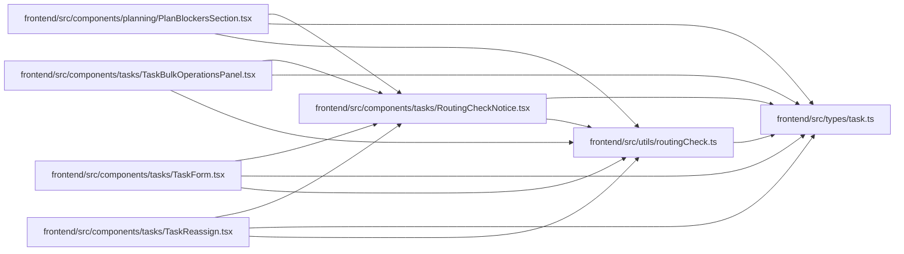

# RoutingCheckNotice Module

**Path:** `frontend/src/components/tasks/RoutingCheckNotice.tsx`

## Description

_Auto-generated from `frontend/src/components/tasks/RoutingCheckNotice.tsx`._

## Imports

| Source | Symbols | Type-only | Runtime emission |
|--------|---------|-----------|------------------|
| `../../types/task` | `RoutingCheck` | Declaration | erased |
| `../../utils/routingCheck` | `RoutingChangeItem` | Specifier | compiler-dependent |
| `../../utils/routingCheck` | `routingChangeLines`, `routingConflicts` | — | compiler-dependent |
| `i18next` | `TFunction` | Declaration | erased |
| `react-i18next` | `useTranslation` | — | compiler-dependent |

## Module Signals

| Signal | Values |
|--------|--------|
| Exports | `RoutingCheckNotice`, `RoutingResultsList` |

## Local dependency map

<!-- Auto-generated local dependency summary. Do not edit by hand. -->
This graph shows full source coupling. Type dependencies can be erased; compiler-dependent cycle groups are runtime candidates, not confirmed initialization cycles.

### Internal neighbors

| Direction | Module |
|---|---|
| Inbound | [PlanBlockersSection](../modules/PlanBlockersSection.md) |
| Inbound | [TaskBulkOperationsPanel](../modules/TaskBulkOperationsPanel.md) |
| Inbound | [TaskForm](../modules/TaskForm.md) |
| Inbound | [TaskReassign](../modules/TaskReassign.md) |
| Outbound | [types_task](../modules/types_task.md) |
| Outbound | [routingCheck](../modules/routingCheck.md) |

### External packages

| Language | Used packages | Undeclared packages |
|---|---:|---:|
| typescript | 2 | 0 |

## Classes

| Class | Kind | Line | Bases / Target | Description |
|-------|------|------|----------------|-------------|
| [Issue](../entities/Issue.md) | Type alias | 6 | `RoutingCheck['issues'][number]` | — |

## Functions

| Function | Signature | Decorators | Description |
|----------|-----------|------------|-------------|
| `RoutingCheckNotice` | `({ check, assigneeName, showSuggestion = true }: { check: RoutingCheck; assigneeName: string; /** False where the suggestion cannot be applied, such as the task form. */ showSuggestion?: boolean })` | — | What a reassignment would do to the task's routing: the conflicts with the project's review |
| `RoutingResultsList` | `({ items, titleOf }: { items: RoutingChangeItem[]; titleOf: (taskId: number) => string })` | — | The tasks a bulk "use the suggested routing" confirmation would change, each with what conflicts |
