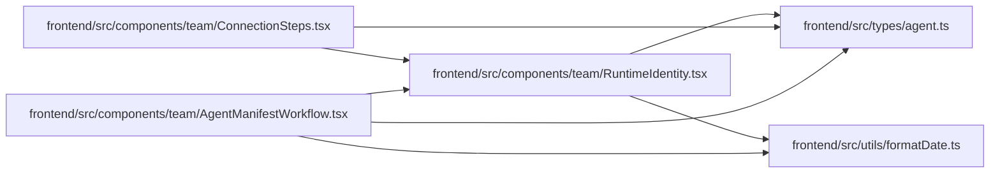

# RuntimeIdentity Module

**Path:** `frontend/src/components/team/RuntimeIdentity.tsx`

## Description

_Auto-generated from `frontend/src/components/team/RuntimeIdentity.tsx`._

## Imports

| Source | Symbols | Type-only | Runtime emission |
|--------|---------|-----------|------------------|
| `../../types/agent` | `AgentTeamRuntimeIdentityStatus` | Declaration | erased |
| `../../utils/formatDate` | `formatDateTime` | — | compiler-dependent |
| `react-i18next` | `useTranslation` | — | compiler-dependent |

## Module Signals

| Signal | Values |
|--------|--------|
| Exports | `RuntimeIdentity` |
| Constants | `P` |

## Local dependency map

<!-- Auto-generated local dependency summary. Do not edit by hand. -->
This graph shows full source coupling. Type dependencies can be erased; compiler-dependent cycle groups are runtime candidates, not confirmed initialization cycles.

### Internal neighbors

| Direction | Module |
|---|---|
| Inbound | [AgentManifestWorkflow](../modules/AgentManifestWorkflow.md) |
| Inbound | [ConnectionSteps](../modules/ConnectionSteps.md) |
| Outbound | [types_agent](../modules/types_agent.md) |
| Outbound | [formatDate](../modules/formatDate.md) |

### External packages

| Language | Used packages | Undeclared packages |
|---|---:|---:|
| typescript | 1 | 0 |

## Functions

| Function | Signature | Decorators | Description |
|----------|-----------|------------|-------------|
| `RuntimeIdentity` | <pre><code>&#40;&#123; identity&#44; acknowledgementState &#125;&#58; &#123;&#10;    identity&#58; AgentTeamRuntimeIdentityStatus &#124; undefined&#59;&#10;    acknowledgementState&#63;&#58; &#39;missing&#39; &#124; &#39;current&#39; &#124; &#39;stale&#39;&#59;&#10;&#125;&#41;</code></pre> | — | Which runtime instance acknowledged an agent's handoff. A change of identity, an acknowledgement under an |
