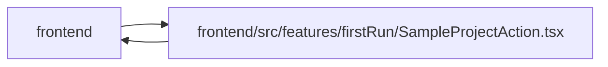

# SampleProjectAction Module

**Path:** `frontend/src/features/firstRun/SampleProjectAction.tsx`

## Description

_Auto-generated from `frontend/src/features/firstRun/SampleProjectAction.tsx`._

## Imports

| Source | Symbols | Type-only | Runtime emission |
|--------|---------|-----------|------------------|
| `../../components/common/Button` | `Button` | — | compiler-dependent |
| `../../components/common/ButtonLink` | `ButtonLink` | — | compiler-dependent |
| `../../components/common/ConfirmDialog` | `ConfirmDialog` | — | compiler-dependent |
| `../../components/common/leaveGuardBypass` | `navigateWithoutLeaveGuards` | — | compiler-dependent |
| `../../hooks/useAdminAccess` | `useAdminAccess` | — | compiler-dependent |
| `../../navigation/scopeParams` | `parseScope` | — | compiler-dependent |
| `../../services/iterationService` | `iterationService` | — | compiler-dependent |
| `../../services/projectService` | `projectService` | — | compiler-dependent |
| `../identity/identityContext` | `useIdentity` | — | compiler-dependent |
| `../scope/scopeStore` | `useScopeStore` | — | compiler-dependent |
| `../scope/useWorkScope` | `useSetWorkScope` | — | compiler-dependent |
| `../scope/workScope` | `ScopeIterationRecord`, `WorkScope` | Specifier | compiler-dependent |
| `../scope/workScope` | `resolveWorkScope`, `sameScope` | — | compiler-dependent |
| `./sampleProject` | `SampleManifest` | Specifier | compiler-dependent |
| `./sampleProject` | `loadSampleProject`, `removeSampleProject`, `SampleWindowUnavailableError` | — | compiler-dependent |
| `./sampleProjectStore` | `useSampleProject` | — | compiler-dependent |
| `@tanstack/react-query` | `useQueryClient` | — | compiler-dependent |
| `react` | `useLayoutEffect`, `useRef`, `useState` | — | compiler-dependent |
| `react-i18next` | `useTranslation` | — | compiler-dependent |
| `react-router-dom` | `useLocation`, `useNavigate` | — | compiler-dependent |

## Module Signals

| Signal | Values |
|--------|--------|
| Exports | `SampleProjectAction` |

## Local dependency map

<!-- Auto-generated local dependency summary. Do not edit by hand. -->
This graph shows full source coupling. Type dependencies can be erased; compiler-dependent cycle groups are runtime candidates, not confirmed initialization cycles.

> Module-level dependencies exceed the generated-diagram limits, so the diagram and table below group them by top-level package. Counts report the number of module neighbors in each package.

### Internal neighbors

| Direction | Module |
|---|---|
| Inbound | `frontend` (2) |
| Outbound | `frontend` (14) |

### External packages

| Language | Used packages | Undeclared packages |
|---|---:|---:|
| typescript | 4 | 0 |

> All 16 module neighbor(s) are summarized by package because the module-level view exceeds the 12-node limit.

## Functions

| Function | Signature | Decorators | Description |
|----------|-----------|------------|-------------|
| `SampleProjectAction` | `()` | — | — |
