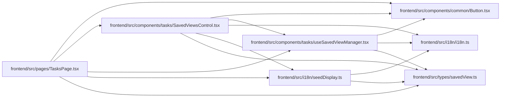

# SavedViewsControl Module

**Path:** `frontend/src/components/tasks/SavedViewsControl.tsx`

## Description

Preserves authenticated saved-view ownership and legacy predicate adaptation. It distinguishes local modifications from saved filters and provides Save changes, Save as and reset controls. Unsaved filters are explicitly local; reloading follows the saved or linked view.

## Imports

| Source | Symbols | Type-only | Runtime emission |
|--------|---------|-----------|------------------|
| `../../i18n/i18n` | `i18n` | — | compiler-dependent |
| `../../i18n/seedDisplay` | `savedViewDisplay` | — | compiler-dependent |
| `../../types/savedView` | `SavedViewScope` | Declaration | erased |
| `../common/Button` | `Button` | — | compiler-dependent |
| `./useSavedViewManager` | `SavedViewManager` | Declaration | erased |
| `clsx` | `clsx` | — | compiler-dependent |
| `lucide-react` | `Check`, `ChevronDown`, `Copy`, `RotateCcw`, `Save`, `Trash2` | — | compiler-dependent |
| `react` | `KeyboardEvent`, `ReactNode` | Declaration | erased |
| `react` | `useEffect`, `useId`, `useRef`, `useState` | — | compiler-dependent |

## Module Signals

| Signal | Values |
|--------|--------|
| Exports | `SavedViewPicker` |
| Constants | `t` |
| Module calls | `t = bind` |

## Local dependency map

<!-- Auto-generated local dependency summary. Do not edit by hand. -->
This graph shows full source coupling. Type dependencies can be erased; compiler-dependent cycle groups are runtime candidates, not confirmed initialization cycles.

### Internal neighbors

| Direction | Module |
|---|---|
| Inbound | [TasksPage](../modules/TasksPage.md) |
| Outbound | [Button](../modules/Button.md) |
| Outbound | [useSavedViewManager](../modules/useSavedViewManager.md) |
| Outbound | [i18n](../modules/i18n.md) |
| Outbound | [seedDisplay](../modules/seedDisplay.md) |
| Outbound | [savedView](../modules/savedView.md) |

### External packages

| Language | Used packages | Undeclared packages |
|---|---:|---:|
| typescript | 3 | 0 |

## Classes

| Class | Kind | Line | Bases / Target | Description |
|-------|------|------|----------------|-------------|
| [PickerItem](../entities/PickerItem.md) | Type alias | 19 | <pre><code>&#124; &#123; kind&#58; &#39;view&#39;&#59; key&#58; string&#59; label&#58; ReactNode&#59; checked&#58; boolean&#59; disabled&#63;&#58; boolean&#59; onSelect&#58; &#40;&#41; &#61;&#62; void &#125;&#10;    &#124; &#123; kind&#58; &#39;action&#39;&#59; key&#58; string&#59; label&#58; ReactNode&#59; icon&#58; ReactNode&#59; disabled&#63;&#58; boolean&#59; tone&#63;&#58; &#39;danger&#39;&#59; onSelect&#58; &#40;&#41; &#61;&#62; void &#125;</code></pre> | — |

## Functions

| Function | Signature | Decorators | Description |
|----------|-----------|------------|-------------|
| `SavedViewPicker` | `({ manager, label }: { manager: SavedViewManager; label: string })` | — | The page title of Tasks: the name of the view shown, opening a menu with every saved view and |
