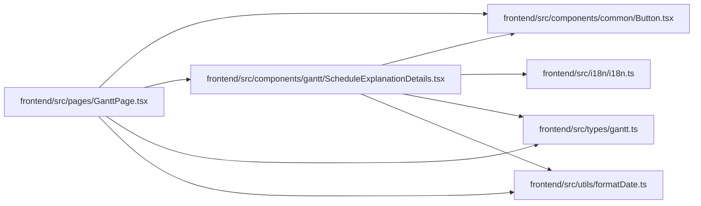

# ScheduleExplanationDetails Module

**Path:** `frontend/src/components/gantt/ScheduleExplanationDetails.tsx`

## Description

_Auto-generated from `frontend/src/components/gantt/ScheduleExplanationDetails.tsx`._

## Imports

| Source | Symbols | Type-only | Runtime emission |
|--------|---------|-----------|------------------|
| `../../i18n/i18n` | `i18n` | — | compiler-dependent |
| `../../types/gantt` | `GanttTask`, `ScheduleDecisionExplanation` | Declaration | erased |
| `../../utils/formatDate` | `formatDate` | — | compiler-dependent |
| `../common/Button` | `Button` | — | compiler-dependent |
| `clsx` | `clsx` | — | compiler-dependent |
| `date-fns` | `addDays`, `format`, `parseISO` | — | compiler-dependent |
| `lucide-react` | `AlertTriangle`, `ChevronDown`, `ChevronRight`, `ExternalLink` | — | compiler-dependent |
| `react` | `useState` | — | compiler-dependent |

## Module Signals

| Signal | Values |
|--------|--------|
| Exports | `ScheduleExplanationDetails` |
| Constants | `t`, `DECISION_BADGE_CLASSES` |
| Module calls | `t = bind` |

## Local dependency map

<!-- Auto-generated local dependency summary. Do not edit by hand. -->
This graph shows full source coupling. Type dependencies can be erased; compiler-dependent cycle groups are runtime candidates, not confirmed initialization cycles.

### Internal neighbors

| Direction | Module |
|---|---|
| Inbound | [GanttPage](../modules/GanttPage.md) |
| Outbound | [Button](../modules/Button.md) |
| Outbound | [i18n](../modules/i18n.md) |
| Outbound | [types_gantt](../modules/types_gantt.md) |
| Outbound | [formatDate](../modules/formatDate.md) |

### External packages

| Language | Used packages | Undeclared packages |
|---|---:|---:|
| typescript | 4 | 0 |

## Classes

| Class | Kind | Line | Bases / Target | Description |
|-------|------|------|----------------|-------------|
| [ScheduleExplanationDetailsProps](../entities/ScheduleExplanationDetailsProps.md) | Interface | 12 | — | — |

## Functions

| Function | Signature | Decorators | Description |
|----------|-----------|------------|-------------|
| `ScheduleExplanationDetails` | <pre><code>&#40;&#123;&#10;    decisions&#44;&#10;    taskLookup&#44;&#10;    memberVacations&#44;&#10;    workloadBalanced&#44;&#10;    workloadIssues&#44;&#10;    onOpenTask&#44;&#10;&#125;&#58; ScheduleExplanationDetailsProps&#41;</code></pre> | — | — |
