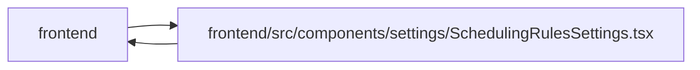

# SchedulingRulesSettings Module

**Path:** `frontend/src/components/settings/SchedulingRulesSettings.tsx`

## Description

_Auto-generated from `frontend/src/components/settings/SchedulingRulesSettings.tsx`._

## Imports

| Source | Symbols | Type-only | Runtime emission |
|--------|---------|-----------|------------------|
| `../../hooks/useAdminAccess` | `useAdminAccess` | — | compiler-dependent |
| `../../services/schedulingRulesService` | `schedulingRulesService` | — | compiler-dependent |
| `../../types/schedulingRules` | `SchedulingRules`, `EffortModifier`, `SchedulingPass`, `Constraints` | Declaration | erased |
| `../../utils/adminAccess` | `getAdminAccessErrorMessage` | — | compiler-dependent |
| `../../utils/protectedQueries` | `protectedQueryRetry` | — | compiler-dependent |
| `../common/Button` | `Button` | — | compiler-dependent |
| `../common/useConfirmDialog` | `useConfirmDialog` | — | compiler-dependent |
| `../feedback/QueryState` | `QueryErrorState` | — | compiler-dependent |
| `../feedback/toast` | `useToast` | — | compiler-dependent |
| `./ConstraintsPanel` | `ConstraintsPanel` | — | compiler-dependent |
| `./EffortModifierCard` | `EffortModifierCard` | — | compiler-dependent |
| `./SchedulingPassCard` | `SchedulingPassCard` | — | compiler-dependent |
| `@dnd-kit/core` | `DragEndEvent` | Declaration | erased |
| `@dnd-kit/core` | `DndContext`, `closestCenter`, `KeyboardSensor`, `PointerSensor`, `useSensor`, `useSensors` | — | compiler-dependent |
| `@dnd-kit/sortable` | `arrayMove`, `SortableContext`, `sortableKeyboardCoordinates`, `verticalListSortingStrategy` | — | compiler-dependent |
| `@tanstack/react-query` | `useQuery`, `useMutation`, `useQueryClient` | — | compiler-dependent |
| `lucide-react` | `AlertTriangle`, `Save`, `RotateCcw`, `ChevronDown`, `ChevronRight`, `Plus`, `Loader2` | — | compiler-dependent |
| `react` | `useState`, `useCallback`, `useMemo` | — | compiler-dependent |
| `react-i18next` | `useTranslation` | — | compiler-dependent |

## Module Signals

| Signal | Values |
|--------|--------|
| Exports | `SchedulingRulesSettings` |
| Constants | `SETTINGS_ROW_ID` |
| Module calls | `SETTINGS_ROW_ID = Symbol` |

## Local dependency map

<!-- Auto-generated local dependency summary. Do not edit by hand. -->
This graph shows full source coupling. Type dependencies can be erased; compiler-dependent cycle groups are runtime candidates, not confirmed initialization cycles.

> Module-level dependencies exceed the generated-diagram limits, so the diagram and table below group them by top-level package. Counts report the number of module neighbors in each package.

### Internal neighbors

| Direction | Module |
|---|---|
| Inbound | `frontend` (2) |
| Outbound | `frontend` (12) |

### External packages

| Language | Used packages | Undeclared packages |
|---|---:|---:|
| typescript | 6 | 0 |

> All 14 module neighbor(s) are summarized by package because the module-level view exceeds the 12-node limit.

## Classes

| Class | Kind | Line | Bases / Target | Description |
|-------|------|------|----------------|-------------|
| [SectionId](../entities/SectionId.md) | Type alias | 33 | `'modifiers' \| 'passes' \| 'constraints'` | — |
| [SettingsRowIdentity](../entities/SettingsRowIdentity.md) | Type alias | 36 | `{ [SETTINGS_ROW_ID]: string }` | — |
| [EditableEffortModifier](../entities/EditableEffortModifier.md) | Type alias | 37 | `EffortModifier & SettingsRowIdentity` | — |
| [EditableSchedulingPass](../entities/EditableSchedulingPass.md) | Type alias | 38 | `SchedulingPass & SettingsRowIdentity` | — |
| [EditableSchedulingRules](../entities/EditableSchedulingRules.md) | Type alias | 39 | <pre><code>Omit&#60;SchedulingRules&#44; &#39;effort&#95;modifiers&#39; &#124; &#39;scheduling&#95;passes&#39;&#62; &#38; &#123;&#10;    effort&#95;modifiers&#58; EditableEffortModifier&#91;&#93;&#59;&#10;    scheduling&#95;passes&#58; EditableSchedulingPass&#91;&#93;&#59;&#10;&#125;</code></pre> | — |

## Functions

| Function | Signature | Decorators | Description |
|----------|-----------|------------|-------------|
| `SchedulingRulesSettings` | `()` | — | — |
