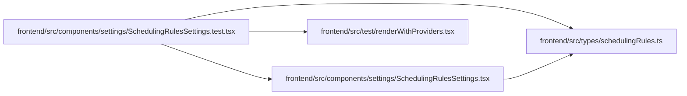

# SchedulingRulesSettings.test Module

**Path:** `frontend/src/components/settings/SchedulingRulesSettings.test.tsx`

## Description

_Auto-generated from `frontend/src/components/settings/SchedulingRulesSettings.test.tsx`._

## Imports

| Source | Symbols | Type-only | Runtime emission |
|--------|---------|-----------|------------------|
| `../../test/renderWithProviders` | `renderWithProviders` | — | compiler-dependent |
| `../../types/schedulingRules` | `SchedulingRules`, `SchedulingRulesResponse` | Declaration | erased |
| `./SchedulingRulesSettings` | `SchedulingRulesSettings` | — | compiler-dependent |
| `@testing-library/react` | `act`, `fireEvent`, `screen`, `waitFor`, `within` | — | compiler-dependent |
| `vitest` | `beforeEach`, `describe`, `expect`, `it`, `vi` | — | compiler-dependent |

## Module Signals

| Signal | Values |
|--------|--------|
| Constants | `adminAccessMock`, `schedulingRulesServiceMock` |
| Module calls | `adminAccessMock = hoisted`, `schedulingRulesServiceMock = hoisted`, `mock`, `mock`, `describe` |

## Local dependency map

<!-- Auto-generated local dependency summary. Do not edit by hand. -->
This graph shows full source coupling. Type dependencies can be erased; compiler-dependent cycle groups are runtime candidates, not confirmed initialization cycles.

### Internal neighbors

| Direction | Module |
|---|---|
| Outbound | [SchedulingRulesSettings](../modules/SchedulingRulesSettings.md) |
| Outbound | [renderWithProviders](../modules/renderWithProviders.md) |
| Outbound | [schedulingRules](../modules/schedulingRules.md) |

### External packages

| Language | Used packages | Undeclared packages |
|---|---:|---:|
| typescript | 2 | 0 |
