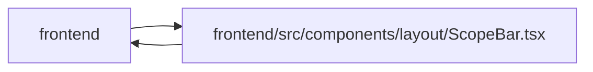

# ScopeBar Module

**Path:** `frontend/src/components/layout/ScopeBar.tsx`

## Description

_Auto-generated from `frontend/src/components/layout/ScopeBar.tsx`._

## Imports

| Source | Symbols | Type-only | Runtime emission |
|--------|---------|-----------|------------------|
| `../../features/scope/useWorkScope` | `useWorkScope` | — | compiler-dependent |
| `../../features/scope/workScope` | `ScopeIteration`, `ScopeProject` | Declaration | erased |
| `../../services/iterationService` | `iterationService` | — | compiler-dependent |
| `../../services/projectService` | `projectService` | — | compiler-dependent |
| `../../types/iteration` | `Iteration` | Declaration | erased |
| `../../types/project` | `Project` | Declaration | erased |
| `../../utils/formatDate` | `formatDate` | — | compiler-dependent |
| `./ScopePicker` | `ScopePickerOption` | Specifier | compiler-dependent |
| `./ScopePicker` | `ScopePicker` | — | compiler-dependent |
| `@tanstack/react-query` | `useQuery` | — | compiler-dependent |
| `react` | `useMemo` | — | compiler-dependent |
| `react-i18next` | `useTranslation` | — | compiler-dependent |
| `react-router-dom` | `useNavigate` | — | compiler-dependent |

## Module Signals

| Signal | Values |
|--------|--------|
| Exports | `ScopeBar` |
| Constants | `ALL_PROJECTS_KEY`, `BACKLOG_KEY`, `NEW_ITERATION_KEY`, `MANAGE_ITERATIONS_KEY`, `PLAN_ITERATIONS_PATH`, `PLAN_NEW_ITERATION_PATH` |

## Local dependency map

<!-- Auto-generated local dependency summary. Do not edit by hand. -->
This graph shows full source coupling. Type dependencies can be erased; compiler-dependent cycle groups are runtime candidates, not confirmed initialization cycles.

> Module-level dependencies exceed the generated-diagram limits, so the diagram and table below group them by top-level package. Counts report the number of module neighbors in each package.

### Internal neighbors

| Direction | Module |
|---|---|
| Inbound | `frontend` (10) |
| Outbound | `frontend` (8) |

### External packages

| Language | Used packages | Undeclared packages |
|---|---:|---:|
| typescript | 4 | 0 |

> All 18 module neighbor(s) are summarized by package because the module-level view exceeds the 12-node limit.

## Functions

| Function | Signature | Decorators | Description |
|----------|-----------|------------|-------------|
| `ScopeBar` | `()` | — | The top bar's Project and Iteration pickers. They set the scope every scoped page shows. |
