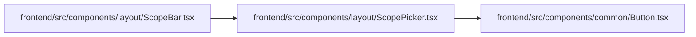

# ScopePicker Module

**Path:** `frontend/src/components/layout/ScopePicker.tsx`

## Description

_Auto-generated from `frontend/src/components/layout/ScopePicker.tsx`._

## Imports

| Source | Symbols | Type-only | Runtime emission |
|--------|---------|-----------|------------------|
| `../../components/common/Button` | `Button` | — | compiler-dependent |
| `clsx` | `clsx` | — | compiler-dependent |
| `lucide-react` | `ChevronDown` | — | compiler-dependent |
| `react` | `KeyboardEvent`, `ReactNode` | Declaration | erased |
| `react` | `useEffect`, `useId`, `useMemo`, `useRef`, `useState` | — | compiler-dependent |

## Module Signals

| Signal | Values |
|--------|--------|
| Exports | `ScopePicker`, `ScopePickerOption` |

## Local dependency map

<!-- Auto-generated local dependency summary. Do not edit by hand. -->
This graph shows full source coupling. Type dependencies can be erased; compiler-dependent cycle groups are runtime candidates, not confirmed initialization cycles.

### Internal neighbors

| Direction | Module |
|---|---|
| Inbound | [ScopeBar](../modules/ScopeBar.md) |
| Outbound | [Button](../modules/Button.md) |

### External packages

| Language | Used packages | Undeclared packages |
|---|---:|---:|
| typescript | 3 | 0 |

## Classes

| Class | Kind | Line | Bases / Target | Description |
|-------|------|------|----------------|-------------|
| [ScopePickerOption](../entities/ScopePickerOption.md) | Interface | 7 | — | — |
| [ScopePickerProps](../entities/ScopePickerProps.md) | Interface | 25 | — | — |

## Functions

| Function | Signature | Decorators | Description |
|----------|-----------|------------|-------------|
| `ScopePicker` | <pre><code>&#40;&#123;&#10;    label&#44;&#10;    valueLabel&#44;&#10;    options&#44;&#10;    onChoose&#44;&#10;    searchHint&#44;&#10;    noMatches&#44;&#10;    disabled &#61; false&#44;&#10;    className&#44;&#10;    renderOption&#44;&#10;&#125;&#58; ScopePickerProps&#41;</code></pre> | — | A combobox with a list that opens below it. Closed, it shows its value; open, the same |
