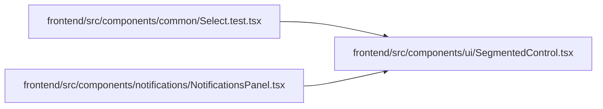

# SegmentedControl Module

**Path:** `frontend/src/components/ui/SegmentedControl.tsx`

## Description

_Auto-generated from `frontend/src/components/ui/SegmentedControl.tsx`._

## Imports

| Source | Symbols | Type-only | Runtime emission |
|--------|---------|-----------|------------------|
| `clsx` | `clsx` | — | compiler-dependent |
| `react` | `ReactNode` | Declaration | erased |

## Module Signals

| Signal | Values |
|--------|--------|
| Exports | `SegmentedControl`, `SegmentedOption` |

## Local dependency map

<!-- Auto-generated local dependency summary. Do not edit by hand. -->

### Internal neighbors

| Direction | Module |
|---|---|
| Inbound | [Select.test](../modules/Select.test.md) |
| Inbound | [NotificationsPanel](../modules/NotificationsPanel.md) |

### External packages

| Language | Used packages | Undeclared packages |
|---|---:|---:|
| typescript | 2 | 0 |

## Classes

| Class | Kind | Line | Bases / Target | Description |
|-------|------|------|----------------|-------------|
| [SegmentedOption](../entities/SegmentedOption.md) | Interface | 4 | — | — |

## Functions

| Function | Signature | Decorators | Description |
|----------|-----------|------------|-------------|
| `SegmentedControl` | <pre><code>&#60;T extends string&#62;&#40;&#123; label&#44; options&#44; value&#44; onChange&#44; disabled&#44; className &#125;&#58; &#123;&#10;    label&#58; string&#59;&#10;    options&#58; SegmentedOption&#60;T&#62;&#91;&#93;&#59;&#10;    value&#58; T&#59;&#10;    onChange&#58; &#40;value&#58; T&#41; &#61;&#62; void&#59;&#10;    disabled&#63;&#58; boolean&#59;&#10;    className&#63;&#58; string&#59;&#10;&#125;&#41;</code></pre> | — | One choice among a few, each a button with a pressed state, named as a group. |
