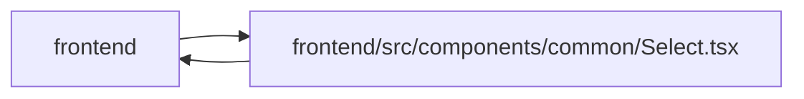

# Select Module

**Path:** `frontend/src/components/common/Select.tsx`

## Description

_Auto-generated from `frontend/src/components/common/Select.tsx`._

## Imports

| Source | Symbols | Type-only | Runtime emission |
|--------|---------|-----------|------------------|
| `./Input` | `RequiredIndicator` | — | compiler-dependent |
| `clsx` | `clsx` | — | compiler-dependent |
| `react` | `ReactNode`, `SelectHTMLAttributes` | Declaration | erased |
| `react` | `forwardRef`, `useId` | — | compiler-dependent |

## Module Signals

| Signal | Values |
|--------|--------|
| Exports | `Select` |
| Constants | `Select` |
| Module calls | `Select = forwardRef` |

## Local dependency map

<!-- Auto-generated local dependency summary. Do not edit by hand. -->

> Module-level dependencies exceed the generated-diagram limits, so the diagram and table below group them by top-level package. Counts report the number of module neighbors in each package.

### Internal neighbors

| Direction | Module |
|---|---|
| Inbound | `frontend` (50) |
| Outbound | `frontend` (1) |

### External packages

| Language | Used packages | Undeclared packages |
|---|---:|---:|
| typescript | 2 | 0 |

> All 51 module neighbor(s) are summarized by package because the module-level view exceeds the 12-node limit.

## Classes

| Class | Kind | Line | Bases / Target | Description |
|-------|------|------|----------------|-------------|
| [SelectProps](../entities/SelectProps.md) | Interface | 6 | `SelectHTMLAttributes<HTMLSelectElement>` | — |
