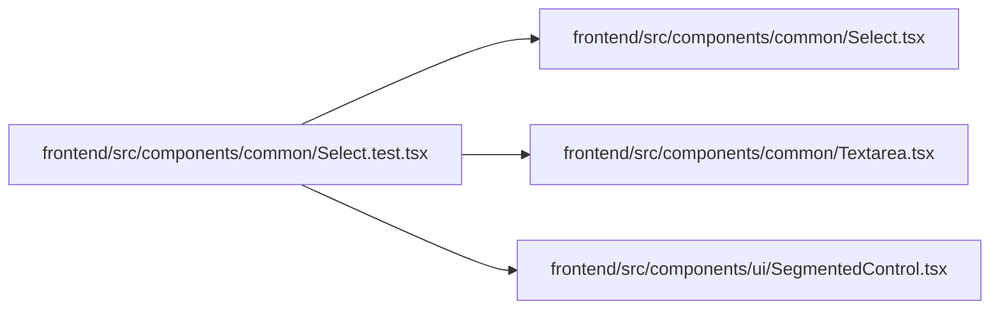

# Select.test Module

**Path:** `frontend/src/components/common/Select.test.tsx`

## Description

_Auto-generated from `frontend/src/components/common/Select.test.tsx`._

## Imports

| Source | Symbols | Type-only | Runtime emission |
|--------|---------|-----------|------------------|
| `../ui/SegmentedControl` | `SegmentedControl` | — | compiler-dependent |
| `./Select` | `Select` | — | compiler-dependent |
| `./Textarea` | `Textarea` | — | compiler-dependent |
| `@testing-library/react` | `render`, `screen` | — | compiler-dependent |
| `@testing-library/user-event` | `userEvent` | — | compiler-dependent |
| `vitest` | `describe`, `expect`, `it`, `vi` | — | compiler-dependent |

## Module Signals

| Signal | Values |
|--------|--------|
| Module calls | `describe` |

## Local dependency map

<!-- Auto-generated local dependency summary. Do not edit by hand. -->

### Internal neighbors

| Direction | Module |
|---|---|
| Outbound | [Select](../modules/Select.md) |
| Outbound | [Textarea](../modules/Textarea.md) |
| Outbound | [SegmentedControl](../modules/SegmentedControl.md) |

### External packages

| Language | Used packages | Undeclared packages |
|---|---:|---:|
| typescript | 3 | 0 |
