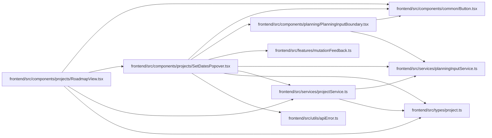

# SetDatesPopover Module

**Path:** `frontend/src/components/projects/SetDatesPopover.tsx`

## Description

_Auto-generated from `frontend/src/components/projects/SetDatesPopover.tsx`._

## Imports

| Source | Symbols | Type-only | Runtime emission |
|--------|---------|-----------|------------------|
| `../../features/mutationFeedback` | `MutationFeedbackMeta` | Specifier | compiler-dependent |
| `../../features/mutationFeedback` | `feedbackMessage` | — | compiler-dependent |
| `../../services/planningInputService` | `ObservedPlanningInput` | Declaration | erased |
| `../../services/projectService` | `projectService` | — | compiler-dependent |
| `../../types/project` | `Project` | Declaration | erased |
| `../../utils/apiError` | `getApiErrorMessage`, `getApiErrorStatus` | — | compiler-dependent |
| `../common/Button` | `Button` | — | compiler-dependent |
| `../planning/PlanningInputBoundary` | `PlanningInputBoundary` | — | compiler-dependent |
| `@tanstack/react-query` | `useMutation`, `useQueryClient` | — | compiler-dependent |
| `date-fns` | `addDays`, `format` | — | compiler-dependent |
| `lucide-react` | `CalendarDays` | — | compiler-dependent |
| `react` | `ReactNode` | Declaration | erased |
| `react` | `useCallback`, `useEffect`, `useId`, `useLayoutEffect`, `useRef`, `useState` | — | compiler-dependent |
| `react-dom` | `createPortal` | — | compiler-dependent |
| `react-i18next` | `useTranslation` | — | compiler-dependent |

## Module Signals

| Signal | Values |
|--------|--------|
| Exports | `SetDatesPopover` |
| Constants | `PANEL_WIDTH`, `GAP`, `EDGE`, `DEFAULT_SPAN_DAYS` |

## Local dependency map

<!-- Auto-generated local dependency summary. Do not edit by hand. -->
This graph shows full source coupling. Type dependencies can be erased; compiler-dependent cycle groups are runtime candidates, not confirmed initialization cycles.

### Internal neighbors

| Direction | Module |
|---|---|
| Inbound | [RoadmapView](../modules/RoadmapView.md) |
| Outbound | [Button](../modules/Button.md) |
| Outbound | [PlanningInputBoundary](../modules/PlanningInputBoundary.md) |
| Outbound | [mutationFeedback](../modules/mutationFeedback.md) |
| Outbound | [planningInputService](../modules/planningInputService.md) |
| Outbound | [projectService](../modules/projectService.md) |
| Outbound | [types_project](../modules/types_project.md) |
| Outbound | [apiError](../modules/apiError.md) |

### External packages

| Language | Used packages | Undeclared packages |
|---|---:|---:|
| typescript | 6 | 0 |

## Classes

| Class | Kind | Line | Bases / Target | Description |
|-------|------|------|----------------|-------------|
| [ProposedDates](../entities/ProposedDates.md) | Type alias | 25 | `{ start: string; target: string }` | Dates to start from instead of today and four weeks on, as `yyyy-MM-dd`. |

## Functions

| Function | Signature | Decorators | Description |
|----------|-----------|------------|-------------|
| `SetDatesPopover` | `({ project, proposed }: { project: Project; proposed?: ProposedDates })` | — | "Set dates" for a project that has none, edited in place: a small popover |
