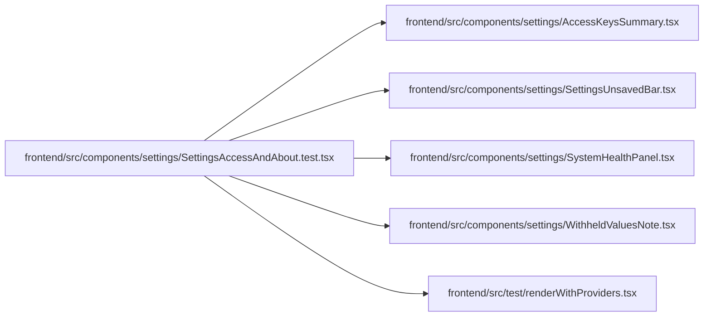

# SettingsAccessAndAbout.test Module

**Path:** `frontend/src/components/settings/SettingsAccessAndAbout.test.tsx`

## Description

_Auto-generated from `frontend/src/components/settings/SettingsAccessAndAbout.test.tsx`._

## Imports

| Source | Symbols | Type-only | Runtime emission |
|--------|---------|-----------|------------------|
| `../../test/renderWithProviders` | `renderWithProviders` | — | compiler-dependent |
| `./AccessKeysSummary` | `AccessKeysSummary` | — | compiler-dependent |
| `./SettingsUnsavedBar` | `SettingsUnsavedBar` | — | compiler-dependent |
| `./SystemHealthPanel` | `SystemHealthPanel` | — | compiler-dependent |
| `./WithheldValuesNote` | `WithheldValuesNote` | — | compiler-dependent |
| `@testing-library/react` | `screen` | — | compiler-dependent |
| `vitest` | `describe`, `expect`, `it`, `vi` | — | compiler-dependent |

## Module Signals

| Signal | Values |
|--------|--------|
| Constants | `health` |
| Module calls | `health = hoisted`, `mock`, `describe` |

## Local dependency map

<!-- Auto-generated local dependency summary. Do not edit by hand. -->

### Internal neighbors

| Direction | Module |
|---|---|
| Outbound | [AccessKeysSummary](../modules/AccessKeysSummary.md) |
| Outbound | [SettingsUnsavedBar](../modules/SettingsUnsavedBar.md) |
| Outbound | [SystemHealthPanel](../modules/SystemHealthPanel.md) |
| Outbound | [WithheldValuesNote](../modules/WithheldValuesNote.md) |
| Outbound | [renderWithProviders](../modules/renderWithProviders.md) |

### External packages

| Language | Used packages | Undeclared packages |
|---|---:|---:|
| typescript | 2 | 0 |
