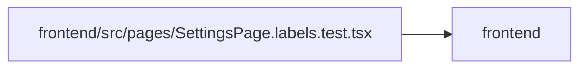

# SettingsPage.labels.test Module

**Path:** `frontend/src/pages/SettingsPage.labels.test.tsx`

## Description

_Auto-generated from `frontend/src/pages/SettingsPage.labels.test.tsx`._

## Imports

| Source | Symbols | Type-only | Runtime emission |
|--------|---------|-----------|------------------|
| `../components/feedback/ToastProvider` | `ToastProvider` | — | compiler-dependent |
| `../components/settings/settingsFieldLabels` | `SettingsSectionId` | Declaration | erased |
| `../components/settings/settingsFieldLabels` | `SETTINGS_FIELD_LABEL_KEYS` | — | compiler-dependent |
| `../features/identity/identityContext` | `IdentityContext` | — | compiler-dependent |
| `../features/identity/identityService` | `WorkspaceIdentity` | Specifier | compiler-dependent |
| `../features/identity/identityService` | `identityService` | — | compiler-dependent |
| `../i18n/i18n` | `i18n`, `ensureLanguageResources` | — | compiler-dependent |
| `../test/renderWithProviders` | `createTestQueryClient`, `renderWithProviders` | — | compiler-dependent |
| `../types/github` | `GitHubStatusAutomationRule` | Declaration | erased |
| `../types/label` | `LabelGroup` | Declaration | erased |
| `../types/outboundWebhook` | `OutboundWebhookTarget` | Declaration | erased |
| `../types/schedulingRules` | `SchedulingRulesResponse` | Declaration | erased |
| `../types/systemSettings` | `SystemSettings` | Declaration | erased |
| `../types/template` | `WorkTemplate` | Declaration | erased |
| `./SettingsPage` | `SettingsPage` | — | compiler-dependent |
| `@tanstack/react-query` | `QueryClientProvider` | — | compiler-dependent |
| `@testing-library/react` | `render`, `screen`, `within` | — | compiler-dependent |
| `@testing-library/user-event` | `userEvent` | — | compiler-dependent |
| `dom-accessibility-api` | `computeAccessibleName` | — | compiler-dependent |
| `react-router-dom` | `createMemoryRouter`, `RouterProvider` | — | compiler-dependent |
| `vitest` | `afterEach`, `beforeEach`, `describe`, `expect`, `it`, `vi` | — | compiler-dependent |

## Module Signals

| Signal | Values |
|--------|--------|
| Constants | `adminAccessMock`, `emailMock`, `healthMock`, `calendarServiceMock`, `planningMock`, `templateServiceMock`, `labelServiceMock`, `rulesServiceMock`, `webhookServiceMock`, `githubServiceMock`, `systemSettingsServiceMock`, `labelGroup`, `rules`, `webhookTarget`, `githubRule`, `systemSettings`, `localIdentity`, `sections` |
| Module calls | `adminAccessMock = hoisted`, `mock`, `emailMock = hoisted`, `mock`, `healthMock = hoisted`, `mock`, `calendarServiceMock = hoisted`, `planningMock = hoisted`, `mock`, `mock`, `templateServiceMock = hoisted`, `labelServiceMock = hoisted`, `rulesServiceMock = hoisted`, `webhookServiceMock = hoisted`, `mock`, `mock`, `mock`, `mock`, `githubServiceMock = hoisted`, `systemSettingsServiceMock = hoisted`, `mock`, `mock`, `describe` |

## Local dependency map

<!-- Auto-generated local dependency summary. Do not edit by hand. -->
This graph shows full source coupling. Type dependencies can be erased; compiler-dependent cycle groups are runtime candidates, not confirmed initialization cycles.

> Module-level dependencies exceed the generated-diagram limits, so the diagram and table below group them by top-level package. Counts report the number of module neighbors in each package.

### Internal neighbors

| Direction | Module |
|---|---|
| Outbound | `frontend` (13) |

### External packages

| Language | Used packages | Undeclared packages |
|---|---:|---:|
| typescript | 6 | 0 |

> All 13 module neighbor(s) are summarized by package because the module-level view exceeds the 12-node limit.
