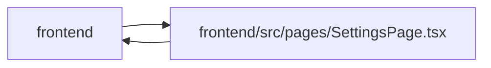

# SettingsPage Module

**Path:** `frontend/src/pages/SettingsPage.tsx`

## Description

_Auto-generated from `frontend/src/pages/SettingsPage.tsx`._

## Imports

| Source | Symbols | Type-only | Runtime emission |
|--------|---------|-----------|------------------|
| `../components/common/Button` | `Button` | — | compiler-dependent |
| `../components/common/Checkbox` | `Checkbox` | — | compiler-dependent |
| `../components/settings/AccessKeysSummary` | `AccessKeysSummary` | — | compiler-dependent |
| `../components/settings/AdminAccessGate` | `AdminAccessGate` | — | compiler-dependent |
| `../components/settings/AdminAccessPanel` | `AdminAccessPanel` | — | compiler-dependent |
| `../components/settings/AgentAccessPanel` | `AgentAccessPanel` | — | compiler-dependent |
| `../components/settings/ConnectedReadersPanel` | `ConnectedReadersPanel` | — | compiler-dependent |
| `../components/settings/EmailSettingsPanel` | `EmailSettingsPanel` | — | compiler-dependent |
| `../components/settings/GitHubSettingsPanel` | `GitHubSettingsPanel` | — | compiler-dependent |
| `../components/settings/InterfaceLanguageSettings` | `InterfaceLanguageSettings` | — | compiler-dependent |
| `../components/settings/OutboundWebhooksPanel` | `OutboundWebhooksPanel` | — | compiler-dependent |
| `../components/settings/ReadOnlyFieldset` | `ReadOnlyFieldset` | — | compiler-dependent |
| `../components/settings/RuntimeConfigSettings` | `RuntimeConfigSettings` | — | compiler-dependent |
| `../components/settings/SchedulingRulesSettings` | `SchedulingRulesSettings` | — | compiler-dependent |
| `../components/settings/SystemHealthPanel` | `SystemHealthPanel` | — | compiler-dependent |
| `../components/settings/TemplateLabelSettings` | `TemplateLabelSettings` | — | compiler-dependent |
| `../components/settings/WorkCalendarSettings` | `WorkCalendarSettings` | — | compiler-dependent |
| `../components/settings/settingsFieldLabels` | `SettingsSectionId` | Declaration | erased |
| `../components/settings/settingsFieldLabels` | `SETTINGS_FIELD_LABEL_KEYS` | — | compiler-dependent |
| `../components/settings/sharedUnlock` | `SharedUnlockContext` | — | compiler-dependent |
| `../components/ui` | `PageHeader`, `PageLayout` | — | compiler-dependent |
| `../hooks/useAdminAccess` | `useAdminAccess`, `useKeylessReader` | — | compiler-dependent |
| `../hooks/useSingleKeyShortcutPreference` | `useSingleKeyShortcutPreference` | — | compiler-dependent |
| `../store/themeStore` | `useThemeStore` | — | compiler-dependent |
| `lucide-react` | `LucideIcon` | Declaration | erased |
| `lucide-react` | `Activity`, `ArrowRight`, `Building2`, `CalendarClock`, `CalendarDays`, `Check`, `Github`, `Globe2`, `Inbox`, `KeyRound`, `Keyboard`, `LockKeyhole`, `Mail`, `Monitor`, `Palette`, `Search`, `ServerCog`, `Sparkles`, `Tags`, `Webhook` | — | compiler-dependent |
| `react` | `KeyboardEvent`, `ReactNode` | Declaration | erased |
| `react` | `useEffect`, `useId`, `useMemo`, `useState` | — | compiler-dependent |
| `react-i18next` | `useTranslation` | — | compiler-dependent |
| `react-router-dom` | `Link`, `Navigate`, `useSearchParams` | — | compiler-dependent |

## Module Signals

| Signal | Values |
|--------|--------|
| Exports | `default` |
| Constants | `SETTINGS_GROUPS`, `SETTINGS_SECTIONS`, `SEARCH_GROUPS`, `DEFAULT_SECTION`, `LAST_SECTION_STORAGE_KEY`, `RENAMED_TABS` |
| Module calls | `SETTINGS_SECTIONS = flatMap` |

## Local dependency map

<!-- Auto-generated local dependency summary. Do not edit by hand. -->
This graph shows full source coupling. Type dependencies can be erased; compiler-dependent cycle groups are runtime candidates, not confirmed initialization cycles.

> Module-level dependencies exceed the generated-diagram limits, so the diagram and table below group them by top-level package. Counts report the number of module neighbors in each package.

### Internal neighbors

| Direction | Module |
|---|---|
| Inbound | `frontend` (5) |
| Outbound | `frontend` (23) |

### External packages

| Language | Used packages | Undeclared packages |
|---|---:|---:|
| typescript | 4 | 0 |

> All 28 module neighbor(s) are summarized by package because the module-level view exceeds the 12-node limit.

## Classes

| Class | Kind | Line | Bases / Target | Description |
|-------|------|------|----------------|-------------|
| [SavedInPart](../entities/SavedInPart.md) | Interface | 57 | — | One part of a section whose parts are kept in different places. |
| [SettingsSection](../entities/SettingsSection.md) | Interface | 63 | — | — |
| [SettingsGroup](../entities/SettingsGroup.md) | Interface | 75 | — | — |
| [SettingsGroupId](../entities/SettingsGroupId.md) | Type alias | 53 | `'myPreferences' \| 'workspace' \| 'connections' \| 'accessSystem'` | — |
| [SavedIn](../entities/SavedIn.md) | Type alias | 55 | `'browser' \| 'workspace'` | Where a section's values are kept: in this browser only, or on the server for everyone. |
