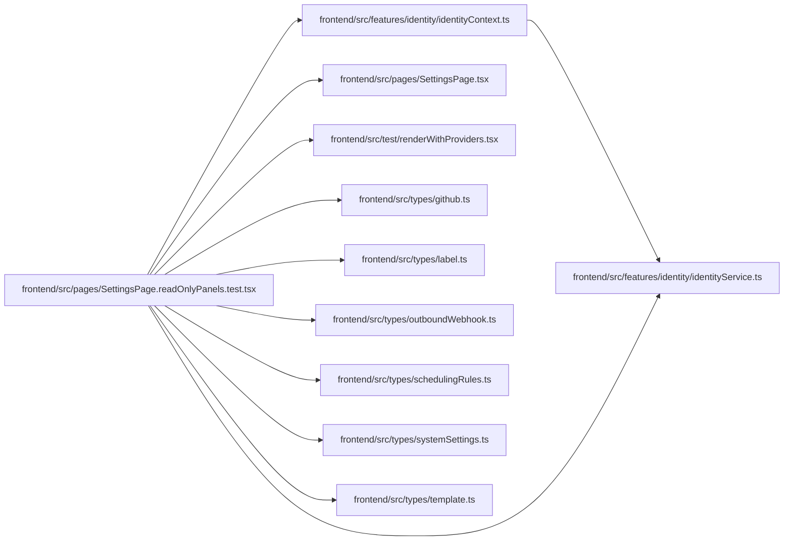

# SettingsPage.readOnlyPanels.test Module

**Path:** `frontend/src/pages/SettingsPage.readOnlyPanels.test.tsx`

## Description

_Auto-generated from `frontend/src/pages/SettingsPage.readOnlyPanels.test.tsx`._

## Imports

| Source | Symbols | Type-only | Runtime emission |
|--------|---------|-----------|------------------|
| `../features/identity/identityContext` | `IdentityContext` | — | compiler-dependent |
| `../features/identity/identityService` | `WorkspaceIdentity` | Declaration | erased |
| `../test/renderWithProviders` | `renderWithProviders` | — | compiler-dependent |
| `../types/github` | `GitHubStatusAutomationRule` | Declaration | erased |
| `../types/label` | `LabelGroup` | Declaration | erased |
| `../types/outboundWebhook` | `OutboundWebhookTarget` | Declaration | erased |
| `../types/schedulingRules` | `SchedulingRulesResponse` | Declaration | erased |
| `../types/systemSettings` | `SystemSettings` | Declaration | erased |
| `../types/template` | `WorkTemplate` | Declaration | erased |
| `./SettingsPage` | `SettingsPage` | — | compiler-dependent |
| `@testing-library/react` | `screen`, `within` | — | compiler-dependent |
| `vitest` | `beforeEach`, `describe`, `expect`, `it`, `vi` | — | compiler-dependent |

## Module Signals

| Signal | Values |
|--------|--------|
| Constants | `templateServiceMock`, `labelServiceMock`, `rulesServiceMock`, `verifyKey`, `webhookServiceMock`, `githubServiceMock`, `systemSettingsServiceMock`, `labelGroup`, `rules`, `webhookTarget`, `githubRule`, `systemSettings`, `reader` |
| Module calls | `templateServiceMock = hoisted`, `labelServiceMock = hoisted`, `rulesServiceMock = hoisted`, `verifyKey = hoisted`, `mock`, `webhookServiceMock = hoisted`, `mock`, `mock`, `mock`, `mock`, `githubServiceMock = hoisted`, `systemSettingsServiceMock = hoisted`, `mock`, `mock`, `describe` |

## Local dependency map

<!-- Auto-generated local dependency summary. Do not edit by hand. -->
This graph shows full source coupling. Type dependencies can be erased; compiler-dependent cycle groups are runtime candidates, not confirmed initialization cycles.

### Internal neighbors

| Direction | Module |
|---|---|
| Outbound | [identityContext](../modules/identityContext.md) |
| Outbound | [identityService](../modules/identityService.md) |
| Outbound | [SettingsPage](../modules/SettingsPage.md) |
| Outbound | [renderWithProviders](../modules/renderWithProviders.md) |
| Outbound | [types_github](../modules/types_github.md) |
| Outbound | [types_label](../modules/types_label.md) |
| Outbound | [outboundWebhook](../modules/outboundWebhook.md) |
| Outbound | [schedulingRules](../modules/schedulingRules.md) |
| Outbound | [systemSettings](../modules/systemSettings.md) |
| Outbound | [types_template](../modules/types_template.md) |

### External packages

| Language | Used packages | Undeclared packages |
|---|---:|---:|
| typescript | 2 | 0 |
