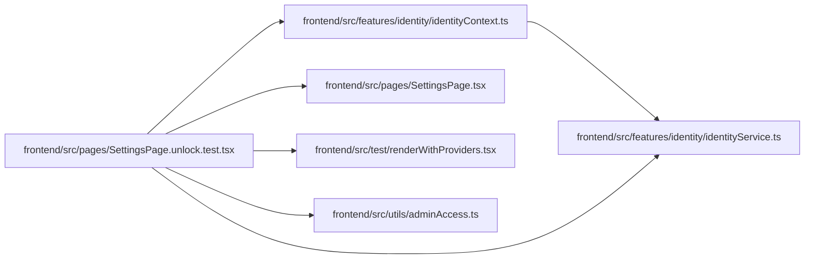

# SettingsPage.unlock.test Module

**Path:** `frontend/src/pages/SettingsPage.unlock.test.tsx`

## Description

_Auto-generated from `frontend/src/pages/SettingsPage.unlock.test.tsx`._

## Imports

| Source | Symbols | Type-only | Runtime emission |
|--------|---------|-----------|------------------|
| `../features/identity/identityContext` | `IdentityContext` | — | compiler-dependent |
| `../features/identity/identityService` | `WorkspaceIdentity` | Declaration | erased |
| `../test/renderWithProviders` | `renderWithProviders` | — | compiler-dependent |
| `../utils/adminAccess` | `ADMIN_API_KEY_STORAGE_KEY` | — | compiler-dependent |
| `./SettingsPage` | `SettingsPage` | — | compiler-dependent |
| `@testing-library/react` | `screen`, `within` | — | compiler-dependent |
| `vitest` | `beforeEach`, `describe`, `expect`, `it`, `vi` | — | compiler-dependent |
| Unresolved `dynamic-import` | — (line 18; deferred) | — | unclassified |

## Module Signals

| Signal | Values |
|--------|--------|
| Constants | `verifyKey`, `{ field, selfLockingField }`, `PROTECTED` |
| Module calls | `verifyKey = hoisted`, `mock`, `{ field, selfLockingField } = hoisted`, `mock`, `mock`, `mock`, `mock`, `mock`, `mock`, `mock`, `mock`, `mock`, `mock`, `describe` |

## Local dependency map

<!-- Auto-generated local dependency summary. Do not edit by hand. -->
This graph shows full source coupling. Type dependencies can be erased; compiler-dependent cycle groups are runtime candidates, not confirmed initialization cycles.

### Internal neighbors

| Direction | Module |
|---|---|
| Outbound | [identityContext](../modules/identityContext.md) |
| Outbound | [identityService](../modules/identityService.md) |
| Outbound | [SettingsPage](../modules/SettingsPage.md) |
| Outbound | [renderWithProviders](../modules/renderWithProviders.md) |
| Outbound | [adminAccess](../modules/adminAccess.md) |

### External packages

| Language | Used packages | Undeclared packages |
|---|---:|---:|
| typescript | 2 | 0 |
