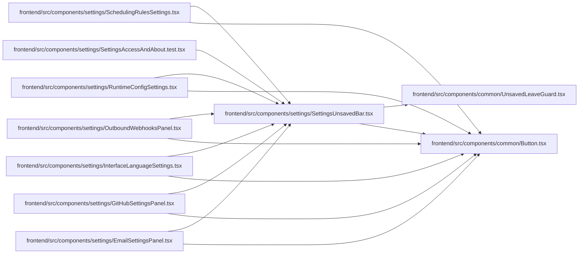

# SettingsUnsavedBar Module

**Path:** `frontend/src/components/settings/SettingsUnsavedBar.tsx`

## Description

_Auto-generated from `frontend/src/components/settings/SettingsUnsavedBar.tsx`._

## Imports

| Source | Symbols | Type-only | Runtime emission |
|--------|---------|-----------|------------------|
| `../common/Button` | `Button` | — | compiler-dependent |
| `../common/UnsavedLeaveGuard` | `UnsavedLeaveGuard` | — | compiler-dependent |
| `react-i18next` | `useTranslation` | — | compiler-dependent |

## Module Signals

| Signal | Values |
|--------|--------|
| Exports | `SettingsUnsavedBar` |

## Local dependency map

<!-- Auto-generated local dependency summary. Do not edit by hand. -->

### Internal neighbors

| Direction | Module |
|---|---|
| Inbound | [EmailSettingsPanel](../modules/EmailSettingsPanel.md) |
| Inbound | [GitHubSettingsPanel](../modules/GitHubSettingsPanel.md) |
| Inbound | [InterfaceLanguageSettings](../modules/InterfaceLanguageSettings.md) |
| Inbound | [OutboundWebhooksPanel](../modules/OutboundWebhooksPanel.md) |
| Inbound | [RuntimeConfigSettings](../modules/RuntimeConfigSettings.md) |
| Inbound | [SchedulingRulesSettings](../modules/SchedulingRulesSettings.md) |
| Inbound | [SettingsAccessAndAbout.test](../modules/SettingsAccessAndAbout.test.md) |
| Outbound | [Button](../modules/Button.md) |
| Outbound | [UnsavedLeaveGuard](../modules/UnsavedLeaveGuard.md) |

### External packages

| Language | Used packages | Undeclared packages |
|---|---:|---:|
| typescript | 1 | 0 |

## Functions

| Function | Signature | Decorators | Description |
|----------|-----------|------------|-------------|
| `SettingsUnsavedBar` | <pre><code>&#40;&#123; dirty&#44; saving &#61; false&#44; onSave&#44; onDiscard&#44; hint &#125;&#58; &#123;&#10;    dirty&#58; boolean&#59; saving&#63;&#58; boolean&#59; onSave&#63;&#58; &#40;&#41; &#61;&#62; void&#59; onDiscard&#63;&#58; &#40;&#41; &#61;&#62; void&#59; hint&#63;&#58; string&#59;&#10;&#125;&#41;</code></pre> | — | Says a settings panel has unsaved changes, keeps Save and Discard in reach, |
