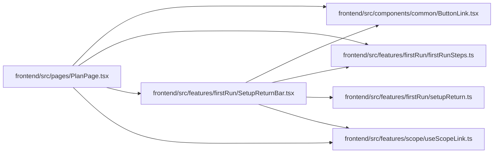

# SetupReturnBar Module

**Path:** `frontend/src/features/firstRun/SetupReturnBar.tsx`

## Description

_Auto-generated from `frontend/src/features/firstRun/SetupReturnBar.tsx`._

## Imports

| Source | Symbols | Type-only | Runtime emission |
|--------|---------|-----------|------------------|
| `../../components/common/ButtonLink` | `ButtonLink` | — | compiler-dependent |
| `../scope/useScopeLink` | `useScopeLink` | — | compiler-dependent |
| `./firstRunSteps` | `FIRST_RUN_SETUP_PARAM` | — | compiler-dependent |
| `./setupReturn` | `useSetupReturn` | — | compiler-dependent |
| `lucide-react` | `ArrowLeft`, `Waypoints` | — | compiler-dependent |
| `react` | `useEffect` | — | compiler-dependent |
| `react-i18next` | `useTranslation` | — | compiler-dependent |
| `react-router-dom` | `useSearchParams` | — | compiler-dependent |

## Module Signals

| Signal | Values |
|--------|--------|
| Exports | `SetupReturnBar` |

## Local dependency map

<!-- Auto-generated local dependency summary. Do not edit by hand. -->

### Internal neighbors

| Direction | Module |
|---|---|
| Inbound | [PlanPage](../modules/PlanPage.md) |
| Outbound | [ButtonLink](../modules/ButtonLink.md) |
| Outbound | [firstRunSteps](../modules/firstRunSteps.md) |
| Outbound | [setupReturn](../modules/setupReturn.md) |
| Outbound | [useScopeLink](../modules/useScopeLink.md) |

### External packages

| Language | Used packages | Undeclared packages |
|---|---:|---:|
| typescript | 4 | 0 |

## Functions

| Function | Signature | Decorators | Description |
|----------|-----------|------------|-------------|
| `SetupReturnBar` | `()` | — | On a page opened from the Get started panel: the way back, where the next step is open. The |
