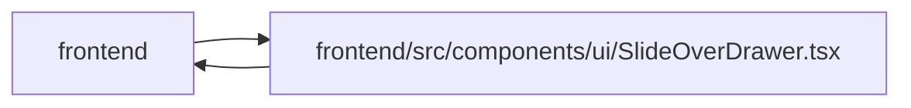

# SlideOverDrawer Module

**Path:** `frontend/src/components/ui/SlideOverDrawer.tsx`

## Description

_Auto-generated from `frontend/src/components/ui/SlideOverDrawer.tsx`._

## Imports

| Source | Symbols | Type-only | Runtime emission |
|--------|---------|-----------|------------------|
| `../common/dialogLayer` | `useDialogLayer` | — | compiler-dependent |
| `lucide-react` | `X` | — | compiler-dependent |
| `react` | `ReactNode`, `RefObject` | Declaration | erased |
| `react` | `useId` | — | compiler-dependent |
| `react-dom` | `createPortal` | — | compiler-dependent |
| `react-i18next` | `useTranslation` | — | compiler-dependent |
| `tailwind-merge` | `twMerge` | — | compiler-dependent |

## Module Signals

| Signal | Values |
|--------|--------|
| Exports | `SlideOverDrawer` |

## Local dependency map

<!-- Auto-generated local dependency summary. Do not edit by hand. -->

> Module-level dependencies exceed the generated-diagram limits, so the diagram and table below group them by top-level package. Counts report the number of module neighbors in each package.

### Internal neighbors

| Direction | Module |
|---|---|
| Inbound | `frontend` (13) |
| Outbound | `frontend` (1) |

### External packages

| Language | Used packages | Undeclared packages |
|---|---:|---:|
| typescript | 5 | 0 |

> All 14 module neighbor(s) are summarized by package because the module-level view exceeds the 12-node limit.

## Functions

| Function | Signature | Decorators | Description |
|----------|-----------|------------|-------------|
| `SlideOverDrawer` | <pre><code>&#40;&#123;&#10;    open&#44;&#10;    title&#44;&#10;    subtitle&#44;&#10;    actions&#44;&#10;    icon&#44;&#10;    children&#44;&#10;    footer&#44;&#10;    onClose&#44;&#10;    ariaLabel&#44;&#10;    className&#44;&#10;    initialFocusRef&#44;&#10;    restoreFocusRef&#44;&#10;    fallbackFocusRef&#44;&#10;    closeOnBackdropClick &#61; true&#44;&#10;    closeDisabled &#61; false&#44;&#10;    closeLabel&#58; closeLabelProp&#44;&#10;&#125;&#58; &#123;&#10;    open&#58; boolean&#59;&#10;    title&#58; ReactNode&#59;&#10;    subtitle&#63;&#58; ReactNode&#59;&#10;    &#47;&#42;&#42; Header actions&#44; shown before the close button&#46; &#42;&#47;&#10;    actions&#63;&#58; ReactNode&#59;&#10;    icon&#63;&#58; ReactNode&#59;&#10;    children&#58; ReactNode&#59;&#10;    footer&#63;&#58; ReactNode&#59;&#10;    onClose&#58; &#40;&#41; &#61;&#62; void&#59;&#10;    ariaLabel&#63;&#58; string&#59;&#10;    className&#63;&#58; string&#59;&#10;    initialFocusRef&#63;&#58; RefObject&#60;HTMLElement &#124; null&#62;&#59;&#10;    restoreFocusRef&#63;&#58; RefObject&#60;HTMLElement &#124; null&#62;&#59;&#10;    &#47;&#42;&#42; Where focus goes on close when the control that opened the drawer is gone&#46; &#42;&#47;&#10;    fallbackFocusRef&#63;&#58; RefObject&#60;HTMLElement &#124; null&#62;&#59;&#10;    closeOnBackdropClick&#63;&#58; boolean&#59;&#10;    closeDisabled&#63;&#58; boolean&#59;&#10;    closeLabel&#63;&#58; string&#59;&#10;&#125;&#41;</code></pre> | — | — |
