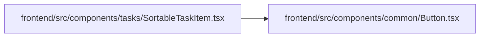

# SortableTaskItem Module

**Path:** `frontend/src/components/tasks/SortableTaskItem.tsx`

## Description

_Auto-generated from `frontend/src/components/tasks/SortableTaskItem.tsx`._

## Imports

| Source | Symbols | Type-only | Runtime emission |
|--------|---------|-----------|------------------|
| `../../components/common/Button` | `Button` | — | compiler-dependent |
| `@dnd-kit/sortable` | `useSortable` | — | compiler-dependent |
| `@dnd-kit/utilities` | `CSS` | — | compiler-dependent |
| `lucide-react` | `GripVertical` | — | compiler-dependent |
| `react` | `ReactNode` | Declaration | erased |
| `react-i18next` | `useTranslation` | — | compiler-dependent |

## Module Signals

| Signal | Values |
|--------|--------|
| Exports | `SortableTaskItem` |

## Local dependency map

<!-- Auto-generated local dependency summary. Do not edit by hand. -->

### Internal neighbors

| Direction | Module |
|---|---|
| Outbound | [Button](../modules/Button.md) |

### External packages

| Language | Used packages | Undeclared packages |
|---|---:|---:|
| typescript | 5 | 0 |

## Classes

| Class | Kind | Line | Bases / Target | Description |
|-------|------|------|----------------|-------------|
| [SortableTaskItemProps](../entities/SortableTaskItemProps.md) | Interface | 8 | — | — |

## Functions

| Function | Signature | Decorators | Description |
|----------|-----------|------------|-------------|
| `SortableTaskItem` | `({ id, children, disabled }: SortableTaskItemProps)` | — | — |
