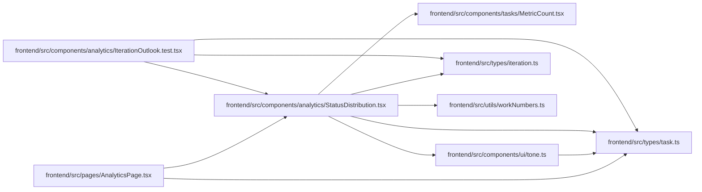

# StatusDistribution Module

**Path:** `frontend/src/components/analytics/StatusDistribution.tsx`

## Description

_Auto-generated from `frontend/src/components/analytics/StatusDistribution.tsx`._

## Imports

| Source | Symbols | Type-only | Runtime emission |
|--------|---------|-----------|------------------|
| `../../types/iteration` | `IterationSummary` | Declaration | erased |
| `../../types/task` | `TaskStatus` | Declaration | erased |
| `../../utils/workNumbers` | `formatCount`, `formatPercent` | — | compiler-dependent |
| `../tasks/MetricCount` | `MetricCount` | — | compiler-dependent |
| `../ui/tone` | `STATUS_TONE`, `toneSoftVar`, `toneVar` | — | compiler-dependent |
| `react-i18next` | `useTranslation` | — | compiler-dependent |

## Module Signals

| Signal | Values |
|--------|--------|
| Exports | `StatusDistribution` |
| Constants | `ORDER` |

## Local dependency map

<!-- Auto-generated local dependency summary. Do not edit by hand. -->
This graph shows full source coupling. Type dependencies can be erased; compiler-dependent cycle groups are runtime candidates, not confirmed initialization cycles.

### Internal neighbors

| Direction | Module |
|---|---|
| Inbound | [IterationOutlook.test](../modules/IterationOutlook.test.md) |
| Inbound | [AnalyticsPage](../modules/AnalyticsPage.md) |
| Outbound | [MetricCount](../modules/MetricCount.md) |
| Outbound | [tone](../modules/tone.md) |
| Outbound | [types_iteration](../modules/types_iteration.md) |
| Outbound | [types_task](../modules/types_task.md) |
| Outbound | [workNumbers](../modules/workNumbers.md) |

### External packages

| Language | Used packages | Undeclared packages |
|---|---:|---:|
| typescript | 1 | 0 |

## Functions

| Function | Signature | Decorators | Description |
|----------|-----------|------------|-------------|
| `StatusDistribution` | `({ summary }: { summary: IterationSummary })` | — | How the iteration's tasks split by status, in the canonical status colours, with a table view. |
