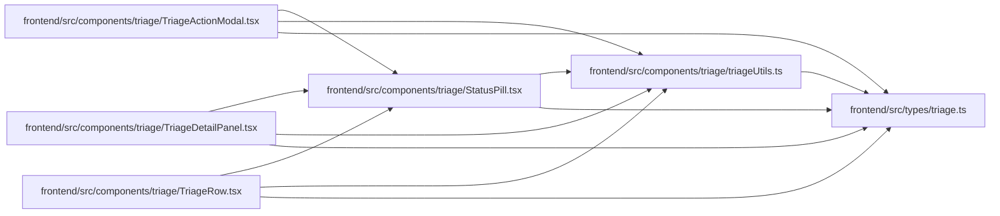

# StatusPill Module

**Path:** `frontend/src/components/triage/StatusPill.tsx`

## Description

_Auto-generated from `frontend/src/components/triage/StatusPill.tsx`._

## Imports

| Source | Symbols | Type-only | Runtime emission |
|--------|---------|-----------|------------------|
| `../../types/triage` | `TriageItemStatus` | Declaration | erased |
| `./triageUtils` | `statusClassName`, `statusLabelKeys`, `t` | — | compiler-dependent |
| `clsx` | `clsx` | — | compiler-dependent |

## Module Signals

| Signal | Values |
|--------|--------|
| Exports | `StatusPill` |

## Local dependency map

<!-- Auto-generated local dependency summary. Do not edit by hand. -->
This graph shows full source coupling. Type dependencies can be erased; compiler-dependent cycle groups are runtime candidates, not confirmed initialization cycles.

### Internal neighbors

| Direction | Module |
|---|---|
| Inbound | [TriageActionModal](../modules/TriageActionModal.md) |
| Inbound | [TriageDetailPanel](../modules/TriageDetailPanel.md) |
| Inbound | [TriageRow](../modules/TriageRow.md) |
| Outbound | [triageUtils](../modules/triageUtils.md) |
| Outbound | [types_triage](../modules/types_triage.md) |

### External packages

| Language | Used packages | Undeclared packages |
|---|---:|---:|
| typescript | 1 | 0 |

## Functions

| Function | Signature | Decorators | Description |
|----------|-----------|------------|-------------|
| `StatusPill` | `({ status }: { status: TriageItemStatus })` | — | — |
