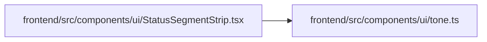

# StatusSegmentStrip Module

**Path:** `frontend/src/components/ui/StatusSegmentStrip.tsx`

## Description

_Auto-generated from `frontend/src/components/ui/StatusSegmentStrip.tsx`._

## Imports

| Source | Symbols | Type-only | Runtime emission |
|--------|---------|-----------|------------------|
| `./tone` | `PillTone` | Declaration | erased |
| `./tone` | `toneVar` | — | compiler-dependent |
| `clsx` | `clsx` | — | compiler-dependent |
| `react` | `ReactNode` | Declaration | erased |

## Module Signals

| Signal | Values |
|--------|--------|
| Exports | `StatusSegment`, `StatusSegmentStrip` |

## Local dependency map

<!-- Auto-generated local dependency summary. Do not edit by hand. -->
This graph shows full source coupling. Type dependencies can be erased; compiler-dependent cycle groups are runtime candidates, not confirmed initialization cycles.

### Internal neighbors

| Direction | Module |
|---|---|
| Outbound | [tone](../modules/tone.md) |

### External packages

| Language | Used packages | Undeclared packages |
|---|---:|---:|
| typescript | 2 | 0 |

## Classes

| Class | Kind | Line | Bases / Target | Description |
|-------|------|------|----------------|-------------|
| [StatusSegment](../entities/StatusSegment.md) | Type alias | 6 | <pre><code>&#123;&#10;    key&#58; string&#59;&#10;    label&#58; ReactNode&#59;&#10;    value&#58; ReactNode&#59;&#10;    tone&#63;&#58; PillTone&#59;&#10;&#125;</code></pre> | — |

## Functions

| Function | Signature | Decorators | Description |
|----------|-----------|------------|-------------|
| `StatusSegmentStrip` | <pre><code>&#40;&#123;&#10;    segments&#44;&#10;    columnsClassName &#61; &#39;grid&#45;cols&#45;2 md&#58;grid&#45;cols&#45;4&#39;&#44;&#10;    className&#44;&#10;&#125;&#58; &#123;&#10;    segments&#58; StatusSegment&#91;&#93;&#59;&#10;    columnsClassName&#63;&#58; string&#59;&#10;    className&#63;&#58; string&#59;&#10;&#125;&#41;</code></pre> | — | — |
