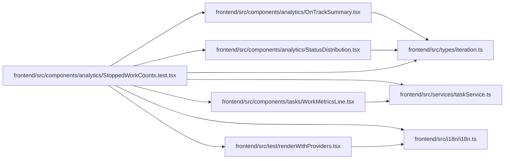

# StoppedWorkCounts.test Module

**Path:** `frontend/src/components/analytics/StoppedWorkCounts.test.tsx`

## Description

_Auto-generated from `frontend/src/components/analytics/StoppedWorkCounts.test.tsx`._

## Imports

| Source | Symbols | Type-only | Runtime emission |
|--------|---------|-----------|------------------|
| `../../i18n/i18n` | `i18n`, `ensureLanguageResources` | — | compiler-dependent |
| `../../services/taskService` | `taskService` | — | compiler-dependent |
| `../../test/renderWithProviders` | `renderWithProviders` | — | compiler-dependent |
| `../../types/iteration` | `IterationSummary` | Declaration | erased |
| `../tasks/WorkMetricsLine` | `WorkMetricsLine` | — | compiler-dependent |
| `./OnTrackSummary` | `OnTrackSummary` | — | compiler-dependent |
| `./StatusDistribution` | `StatusDistribution` | — | compiler-dependent |
| `@testing-library/react` | `screen`, `within` | — | compiler-dependent |
| `vitest` | `beforeEach`, `describe`, `expect`, `it`, `vi` | — | compiler-dependent |

## Module Signals

| Signal | Values |
|--------|--------|
| Module calls | `mock`, `beforeEach`, `describe` |

## Local dependency map

<!-- Auto-generated local dependency summary. Do not edit by hand. -->
This graph shows full source coupling. Type dependencies can be erased; compiler-dependent cycle groups are runtime candidates, not confirmed initialization cycles.

### Internal neighbors

| Direction | Module |
|---|---|
| Outbound | [OnTrackSummary](../modules/OnTrackSummary.md) |
| Outbound | [StatusDistribution](../modules/StatusDistribution.md) |
| Outbound | [WorkMetricsLine](../modules/WorkMetricsLine.md) |
| Outbound | [i18n](../modules/i18n.md) |
| Outbound | [taskService](../modules/taskService.md) |
| Outbound | [renderWithProviders](../modules/renderWithProviders.md) |
| Outbound | [types_iteration](../modules/types_iteration.md) |

### External packages

| Language | Used packages | Undeclared packages |
|---|---:|---:|
| typescript | 2 | 0 |
