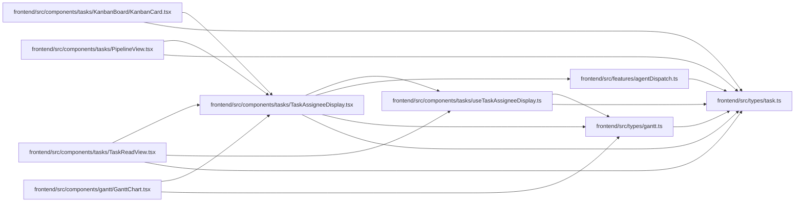

# TaskAssigneeDisplay Module

**Path:** `frontend/src/components/tasks/TaskAssigneeDisplay.tsx`

## Description

_Auto-generated from `frontend/src/components/tasks/TaskAssigneeDisplay.tsx`._

## Imports

| Source | Symbols | Type-only | Runtime emission |
|--------|---------|-----------|------------------|
| `../../features/agentDispatch` | `AGENT_DISPATCH_LABEL_KEY` | — | compiler-dependent |
| `../../types/gantt` | `GanttTask` | Declaration | erased |
| `../../types/task` | `Task` | Declaration | erased |
| `./useTaskAssigneeDisplay` | `useTaskAssigneeDisplay` | — | compiler-dependent |
| `lucide-react` | `Bot`, `User` | — | compiler-dependent |
| `react-i18next` | `useTranslation` | — | compiler-dependent |

## Module Signals

| Signal | Values |
|--------|--------|
| Exports | `TaskAssigneeDisplay` |

## Local dependency map

<!-- Auto-generated local dependency summary. Do not edit by hand. -->
This graph shows full source coupling. Type dependencies can be erased; compiler-dependent cycle groups are runtime candidates, not confirmed initialization cycles.

### Internal neighbors

| Direction | Module |
|---|---|
| Inbound | [GanttChart](../modules/GanttChart.md) |
| Inbound | [KanbanCard](../modules/KanbanCard.md) |
| Inbound | [PipelineView](../modules/PipelineView.md) |
| Inbound | [TaskReadView](../modules/TaskReadView.md) |
| Outbound | [useTaskAssigneeDisplay](../modules/useTaskAssigneeDisplay.md) |
| Outbound | [agentDispatch](../modules/agentDispatch.md) |
| Outbound | [types_gantt](../modules/types_gantt.md) |
| Outbound | [types_task](../modules/types_task.md) |

### External packages

| Language | Used packages | Undeclared packages |
|---|---:|---:|
| typescript | 2 | 0 |

## Functions

| Function | Signature | Decorators | Description |
|----------|-----------|------------|-------------|
| `TaskAssigneeDisplay` | `({ task, iterationId, bar = false, durationDays }: { task: Task \| GanttTask; iterationId: number \| null; bar?: boolean; durationDays?: number })` | — | The same capacity identity and dispatch line used by the task row, with its Reviewer beside it. |
