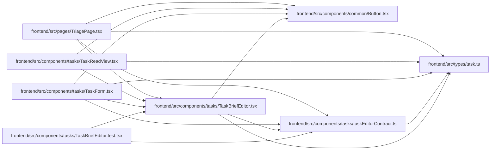

# TaskBriefEditor Module

**Path:** `frontend/src/components/tasks/TaskBriefEditor.tsx`

## Description

_Auto-generated from `frontend/src/components/tasks/TaskBriefEditor.tsx`._

## Imports

| Source | Symbols | Type-only | Runtime emission |
|--------|---------|-----------|------------------|
| `../../types/task` | `TaskBrief` | Declaration | erased |
| `../common/Button` | `Button` | — | compiler-dependent |
| `./taskEditorContract` | `newCriterion` | — | compiler-dependent |
| `lucide-react` | `ArrowDown`, `ArrowUp`, `Plus`, `Trash2` | — | compiler-dependent |
| `react` | `useId` | — | compiler-dependent |
| `react-i18next` | `useTranslation` | — | compiler-dependent |

## Module Signals

| Signal | Values |
|--------|--------|
| Exports | `TaskBriefEditor` |

## Local dependency map

<!-- Auto-generated local dependency summary. Do not edit by hand. -->
This graph shows full source coupling. Type dependencies can be erased; compiler-dependent cycle groups are runtime candidates, not confirmed initialization cycles.

### Internal neighbors

| Direction | Module |
|---|---|
| Inbound | [TaskBriefEditor.test](../modules/TaskBriefEditor.test.md) |
| Inbound | [TaskForm](../modules/TaskForm.md) |
| Inbound | [TaskReadView](../modules/TaskReadView.md) |
| Inbound | [TriagePage](../modules/TriagePage.md) |
| Outbound | [Button](../modules/Button.md) |
| Outbound | [taskEditorContract](../modules/taskEditorContract.md) |
| Outbound | [types_task](../modules/types_task.md) |

### External packages

| Language | Used packages | Undeclared packages |
|---|---:|---:|
| typescript | 3 | 0 |

## Functions

| Function | Signature | Decorators | Description |
|----------|-----------|------------|-------------|
| `TaskBriefEditor` | <pre><code>&#40;&#123; value&#44; onChange&#44; disabled &#61; false&#44; hideContext &#61; false &#125;&#58; &#123;&#10;    value&#58; TaskBrief&#59; onChange&#58; &#40;value&#58; TaskBrief&#41; &#61;&#62; void&#59; disabled&#63;&#58; boolean&#59; hideContext&#63;&#58; boolean&#59;&#10;&#125;&#41;</code></pre> | — | — |
