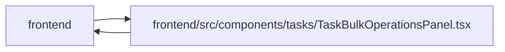

# TaskBulkOperationsPanel Module

**Path:** `frontend/src/components/tasks/TaskBulkOperationsPanel.tsx`

## Description

_Auto-generated from `frontend/src/components/tasks/TaskBulkOperationsPanel.tsx`._

## Imports

| Source | Symbols | Type-only | Runtime emission |
|--------|---------|-----------|------------------|
| `../../components/common/Select` | `Select` | — | compiler-dependent |
| `../../features/mutationFeedback` | `MutationFeedbackMeta` | Declaration | erased |
| `../../services/iterationService` | `iterationService` | — | compiler-dependent |
| `../../services/projectService` | `projectService` | — | compiler-dependent |
| `../../services/taskService` | `taskService` | — | compiler-dependent |
| `../../services/teamService` | `teamService` | — | compiler-dependent |
| `../../types/task` | `Task`, `TaskBulkAction`, `TaskStatus` | Declaration | erased |
| `../../utils/apiError` | `getApiErrorMessage` | — | compiler-dependent |
| `../common/Button` | `Button` | — | compiler-dependent |
| `../feedback/QueryState` | `QueryErrorState` | — | compiler-dependent |
| `../ui/OverflowMenu` | `OverflowMenu` | — | compiler-dependent |
| `@tanstack/react-query` | `useMutation`, `useQuery`, `useQueryClient` | — | compiler-dependent |
| `lucide-react` | `Trash2` | — | compiler-dependent |
| `react` | `useEffect`, `useMemo`, `useRef`, `useState` | — | compiler-dependent |
| `react-i18next` | `useTranslation` | — | compiler-dependent |

## Module Signals

| Signal | Values |
|--------|--------|
| Exports | `BulkSelectedTask`, `TaskBulkOperationsPanel` |
| Constants | `STATUS_OPTIONS`, `AUTO`, `NONE`, `selectClassName` |

## Local dependency map

<!-- Auto-generated local dependency summary. Do not edit by hand. -->
This graph shows full source coupling. Type dependencies can be erased; compiler-dependent cycle groups are runtime candidates, not confirmed initialization cycles.

> Module-level dependencies exceed the generated-diagram limits, so the diagram and table below group them by top-level package. Counts report the number of module neighbors in each package.

### Internal neighbors

| Direction | Module |
|---|---|
| Inbound | `frontend` (2) |
| Outbound | `frontend` (11) |

### External packages

| Language | Used packages | Undeclared packages |
|---|---:|---:|
| typescript | 4 | 0 |

> All 13 module neighbor(s) are summarized by package because the module-level view exceeds the 12-node limit.

## Classes

| Class | Kind | Line | Bases / Target | Description |
|-------|------|------|----------------|-------------|
| [BulkRejected](../entities/BulkRejected.md) | Class | 41 | `Error` | — |
| [TaskBulkOperationsPanelProps](../entities/TaskBulkOperationsPanelProps.md) | Interface | 22 | — | — |
| [BulkKind](../entities/BulkKind.md) | Type alias | 17 | `'assign' \| 'status' \| 'priority' \| 'iteration' \| 'project' \| 'clearProject' \| 'milestone' \| 'clearMilestone' \| 'addLabels' \| 'removeLabels' \| 'flags' \| 'delete'` | — |
| [BulkSelectedTask](../entities/BulkSelectedTask.md) | Type alias | 20 | `Pick<Task, 'id' \| 'title' \| 'version'>` | What the bar needs of a selected task. |

## Functions

| Function | Signature | Decorators | Description |
|----------|-----------|------------|-------------|
| `TaskBulkOperationsPanel` | <pre><code>&#40;&#123;&#10;    iterationId&#44; selectedTasks&#44; matchingCount&#44; onSelectAll&#44; onClearSelection&#44; onMerge&#44; openAssign &#61; false&#44;&#10;&#125;&#58; TaskBulkOperationsPanelProps&#41;</code></pre> | — | The bar shown while tasks are selected. Each change is one choice and one Apply: the server |
