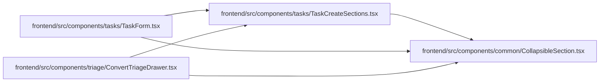

# TaskCreateSections Module

**Path:** `frontend/src/components/tasks/TaskCreateSections.tsx`

## Description

_Auto-generated from `frontend/src/components/tasks/TaskCreateSections.tsx`._

## Imports

| Source | Symbols | Type-only | Runtime emission |
|--------|---------|-----------|------------------|
| `../common/CollapsibleSection` | `CollapsibleSection` | — | compiler-dependent |
| `react` | `ReactNode` | Declaration | erased |
| `react-i18next` | `useTranslation` | — | compiler-dependent |

## Module Signals

| Signal | Values |
|--------|--------|
| Exports | `TaskCreateSections` |

## Local dependency map

<!-- Auto-generated local dependency summary. Do not edit by hand. -->

### Internal neighbors

| Direction | Module |
|---|---|
| Inbound | [TaskForm](../modules/TaskForm.md) |
| Inbound | [ConvertTriageDrawer](../modules/ConvertTriageDrawer.md) |
| Outbound | [CollapsibleSection](../modules/CollapsibleSection.md) |

### External packages

| Language | Used packages | Undeclared packages |
|---|---:|---:|
| typescript | 2 | 0 |

## Functions

| Function | Signature | Decorators | Description |
|----------|-----------|------------|-------------|
| `TaskCreateSections` | <pre><code>&#40;&#123; title&#44; assignee&#44; effort&#44; brief&#44; assistance&#44; context&#44; more&#44; moreOpen&#44; onMoreOpenChange &#125;&#58; &#123;&#10;    title&#58; ReactNode&#59; assignee&#58; ReactNode&#59; effort&#58; ReactNode&#59; brief&#58; ReactNode&#59;&#10;    assistance&#63;&#58; ReactNode&#59; context&#63;&#58; ReactNode&#59; more&#58; ReactNode&#59;&#10;    moreOpen&#63;&#58; boolean&#59; onMoreOpenChange&#63;&#58; &#40;open&#58; boolean&#41; &#61;&#62; void&#59;&#10;&#125;&#41;</code></pre> | — | The short create form shared by task capture and request conversion. |
