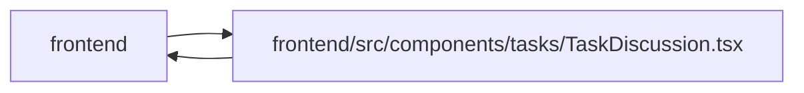

# TaskDiscussion Module

**Path:** `frontend/src/components/tasks/TaskDiscussion.tsx`

## Description

Keeps discussion distinct from execution and acceptance. Plain-text comments preserve authorship, versioned edits and history. Same-account drafts retain edit identity and mentions; conflicts require an explicit current-version comparison. Subscription settings, pending states and errors remain visible without dismissing the task editor.

Comment drafts checkpoint uncertainty before writing and retain input through missing responses. A current read and explicit comparison are required to resume; confirmed version conflicts retain the original edit observation until deliberate reapplication. Operation markers prevent obsolete acknowledgments from clearing newer local input.

## Imports

| Source | Symbols | Type-only | Runtime emission |
|--------|---------|-----------|------------------|
| `../../components/feedback/LiveWindowStatus` | `LiveWindowStatus` | — | compiler-dependent |
| `../../features/identity/identityContext` | `useIdentity` | — | compiler-dependent |
| `../../features/useLiveWindow` | `useLiveWindow` | — | compiler-dependent |
| `../../services/discussionService` | `TaskComment` | Declaration | erased |
| `../../services/discussionService` | `discussionService` | — | compiler-dependent |
| `../../utils/apiError` | `getApiErrorMessage` | — | compiler-dependent |
| `../../utils/formatDate` | `formatDateTime` | — | compiler-dependent |
| `../common/Button` | `Button` | — | compiler-dependent |
| `../feedback/QueryState` | `QueryErrorState` | — | compiler-dependent |
| `./useDraftDismissal` | `useActiveMount` | — | compiler-dependent |
| `@tanstack/react-query` | `useInfiniteQuery`, `useMutation`, `useQuery` | — | compiler-dependent |
| `react` | `useEffect`, `useId`, `useState` | — | compiler-dependent |
| `react-i18next` | `useTranslation` | — | compiler-dependent |

## Module Signals

| Signal | Values |
|--------|--------|
| Exports | `TaskDiscussion` |

## Local dependency map

<!-- Auto-generated local dependency summary. Do not edit by hand. -->
This graph shows full source coupling. Type dependencies can be erased; compiler-dependent cycle groups are runtime candidates, not confirmed initialization cycles.

> Module-level dependencies exceed the generated-diagram limits, so the diagram and table below group them by top-level package. Counts report the number of module neighbors in each package.

### Internal neighbors

| Direction | Module |
|---|---|
| Inbound | `frontend` (3) |
| Outbound | `frontend` (9) |

### External packages

| Language | Used packages | Undeclared packages |
|---|---:|---:|
| typescript | 3 | 0 |

> All 12 module neighbor(s) are summarized by package because the module-level view exceeds the 12-node limit.

## Classes

| Class | Kind | Line | Bases / Target | Description |
|-------|------|------|----------------|-------------|
| [EditingComment](../entities/EditingComment.md) | Type alias | 15 | `Pick<TaskComment, 'id' \| 'version'>` | — |

## Functions

| Function | Signature | Decorators | Description |
|----------|-----------|------------|-------------|
| `TaskDiscussion` | <pre><code>&#40;&#123; taskId&#44; draftKey&#44; disabled&#44; onDirty&#44; onPending &#125;&#58; &#123;&#10;    taskId&#58; number&#59; draftKey&#58; string &#124; null&#59; disabled&#58; boolean&#59;&#10;    onDirty&#58; &#40;dirty&#58; boolean&#41; &#61;&#62; void&#59; onPending&#58; &#40;pending&#58; boolean&#41; &#61;&#62; void&#59;&#10;&#125;&#41;</code></pre> | — | — |