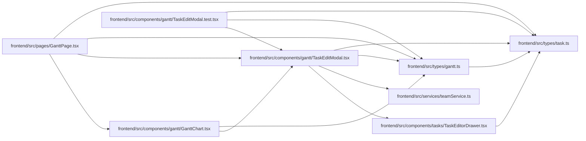

# TaskEditModal Module

**Path:** `frontend/src/components/gantt/TaskEditModal.tsx`

## Description

_Auto-generated from `frontend/src/components/gantt/TaskEditModal.tsx`._

## Imports

| Source | Symbols | Type-only | Runtime emission |
|--------|---------|-----------|------------------|
| `../../services/teamService` | `teamService` | — | compiler-dependent |
| `../../types/gantt` | `GanttTask` | Declaration | erased |
| `../../types/task` | `Task`, `TaskUpdate` | Declaration | erased |
| `../tasks/TaskEditorDrawer` | `TaskEditorDrawer` | — | compiler-dependent |
| `@tanstack/react-query` | `useQuery` | — | compiler-dependent |
| `react` | `useCallback` | — | compiler-dependent |

## Module Signals

| Signal | Values |
|--------|--------|
| Exports | `TaskEditModal` |

## Local dependency map

<!-- Auto-generated local dependency summary. Do not edit by hand. -->
This graph shows full source coupling. Type dependencies can be erased; compiler-dependent cycle groups are runtime candidates, not confirmed initialization cycles.

### Internal neighbors

| Direction | Module |
|---|---|
| Inbound | [GanttChart](../modules/GanttChart.md) |
| Inbound | [TaskEditModal.test](../modules/TaskEditModal.test.md) |
| Inbound | [GanttPage](../modules/GanttPage.md) |
| Outbound | [TaskEditorDrawer](../modules/TaskEditorDrawer.md) |
| Outbound | [teamService](../modules/teamService.md) |
| Outbound | [types_gantt](../modules/types_gantt.md) |
| Outbound | [types_task](../modules/types_task.md) |

### External packages

| Language | Used packages | Undeclared packages |
|---|---:|---:|
| typescript | 2 | 0 |

## Classes

| Class | Kind | Line | Bases / Target | Description |
|-------|------|------|----------------|-------------|
| [TaskEditModalProps](../entities/TaskEditModalProps.md) | Interface | 8 | — | — |

## Functions

| Function | Signature | Decorators | Description |
|----------|-----------|------------|-------------|
| `TaskEditModal` | <pre><code>&#40;&#123;&#10;    task&#44;&#10;    iterationId&#44;&#10;    isOpen&#44;&#10;    onClose&#44;&#10;    sandboxMode &#61; false&#44;&#10;    onSaveSandbox&#44;&#10;&#125;&#58; TaskEditModalProps&#41;</code></pre> | — | Opens a Gantt task in the same task drawer as the other views: read first, with |
