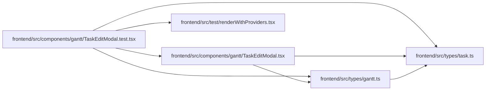

# TaskEditModal.test Module

**Path:** `frontend/src/components/gantt/TaskEditModal.test.tsx`

## Description

_Auto-generated from `frontend/src/components/gantt/TaskEditModal.test.tsx`._

## Imports

| Source | Symbols | Type-only | Runtime emission |
|--------|---------|-----------|------------------|
| `../../test/renderWithProviders` | `renderWithProviders` | — | compiler-dependent |
| `../../types/gantt` | `GanttTask` | Declaration | erased |
| `../../types/task` | `TaskDetail`, `TaskUpdate` | Declaration | erased |
| `./TaskEditModal` | `TaskEditModal` | — | compiler-dependent |
| `@testing-library/react` | `act`, `fireEvent`, `screen` | — | compiler-dependent |
| `vitest` | `expect`, `it`, `vi` | — | compiler-dependent |

## Module Signals

| Signal | Values |
|--------|--------|
| Constants | `api`, `ganttTask` |
| Module calls | `api = hoisted`, `mock`, `mock`, `mock`, `mock`, `mock`, `it`, `it` |

## Local dependency map

<!-- Auto-generated local dependency summary. Do not edit by hand. -->
This graph shows full source coupling. Type dependencies can be erased; compiler-dependent cycle groups are runtime candidates, not confirmed initialization cycles.

### Internal neighbors

| Direction | Module |
|---|---|
| Outbound | [TaskEditModal](../modules/TaskEditModal.md) |
| Outbound | [renderWithProviders](../modules/renderWithProviders.md) |
| Outbound | [types_gantt](../modules/types_gantt.md) |
| Outbound | [types_task](../modules/types_task.md) |

### External packages

| Language | Used packages | Undeclared packages |
|---|---:|---:|
| typescript | 2 | 0 |
