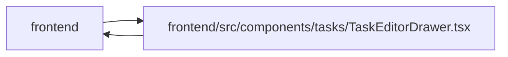

# TaskEditorDrawer Module

**Path:** `frontend/src/components/tasks/TaskEditorDrawer.tsx`

## Description

Each drawer opening now retains its initial coherent snapshot while the user types. Explicit context reload goes through the established dirty/pending dismissal guard and remounts the form only with the deliberately chosen current version. Snapshot requests are abortable and lower-version responses are ignored.

## Imports

| Source | Symbols | Type-only | Runtime emission |
|--------|---------|-----------|------------------|
| `../../types/task` | `Task`, `TaskUpdate` | Declaration | erased |
| `../common/Button` | `Button` | — | compiler-dependent |
| `../ui/SlideOverDrawer` | `SlideOverDrawer` | — | compiler-dependent |
| `./DraftDismissalDialog` | `DraftDismissalDialog` | — | compiler-dependent |
| `./TaskContextSummary` | `TaskContextSummary` | — | compiler-dependent |
| `./TaskForm` | `TaskForm` | — | compiler-dependent |
| `./taskEditorSnapshot` | `readTaskEditorSnapshot`, `keepNewestTaskSnapshot` | — | compiler-dependent |
| `./useDraftDismissal` | `useDraftDismissal` | — | compiler-dependent |
| `@tanstack/react-query` | `useQuery` | — | compiler-dependent |
| `lucide-react` | `Loader2` | — | compiler-dependent |
| `react` | `ReactNode`, `RefObject` | Declaration | erased |
| `react` | `useId`, `useMemo`, `useState` | — | compiler-dependent |
| `react-i18next` | `useTranslation` | — | compiler-dependent |
| `react-router-dom` | `useNavigate`, `useSearchParams` | — | compiler-dependent |

## Module Signals

| Signal | Values |
|--------|--------|
| Exports | `TaskEditorDrawer` |

## Local dependency map

<!-- Auto-generated local dependency summary. Do not edit by hand. -->
This graph shows full source coupling. Type dependencies can be erased; compiler-dependent cycle groups are runtime candidates, not confirmed initialization cycles.

> Module-level dependencies exceed the generated-diagram limits, so the diagram and table below group them by top-level package. Counts report the number of module neighbors in each package.

### Internal neighbors

| Direction | Module |
|---|---|
| Inbound | `frontend` (4) |
| Outbound | `frontend` (8) |

### External packages

| Language | Used packages | Undeclared packages |
|---|---:|---:|
| typescript | 5 | 0 |

> All 12 module neighbor(s) are summarized by package because the module-level view exceeds the 12-node limit.

## Classes

| Class | Kind | Line | Bases / Target | Description |
|-------|------|------|----------------|-------------|
| [DrawerCopy](../entities/DrawerCopy.md) | Type alias | 16 | `ReactNode \| ((task: Task \| null) => ReactNode)` | — |

## Functions

| Function | Signature | Decorators | Description |
|----------|-----------|------------|-------------|
| `TaskEditorDrawer` | <pre><code>&#40;&#123;&#10;    taskId&#44;&#10;    iterationId&#44;&#10;    open&#44;&#10;    onClose&#44;&#10;    mode &#61; &#39;direct&#39;&#44;&#10;    prepareTask&#44;&#10;    onSaveSandbox&#44;&#10;    title&#44;&#10;    subtitle&#44;&#10;    icon&#44;&#10;    beforeForm&#44;&#10;    className&#44;&#10;    restoreFocusRef&#44;&#10;&#125;&#58; &#123;&#10;    taskId&#58; number &#124; null&#59;&#10;    iterationId&#63;&#58; number&#59;&#10;    open&#58; boolean&#59;&#10;    onClose&#58; &#40;&#41; &#61;&#62; void&#59;&#10;    mode&#63;&#58; &#39;direct&#39; &#124; &#39;sandbox&#39;&#59;&#10;    prepareTask&#63;&#58; &#40;task&#58; Task&#41; &#61;&#62; Task&#59;&#10;    onSaveSandbox&#63;&#58; &#40;update&#58; TaskUpdate&#41; &#61;&#62; void&#59;&#10;    title&#63;&#58; DrawerCopy&#59;&#10;    subtitle&#63;&#58; DrawerCopy&#59;&#10;    icon&#63;&#58; ReactNode&#59;&#10;    beforeForm&#63;&#58; ReactNode&#59;&#10;    className&#63;&#58; string&#59;&#10;    restoreFocusRef&#63;&#58; RefObject&#60;HTMLElement &#124; null&#62;&#59;&#10;&#125;&#41;</code></pre> | — | — |